# Cadastro por documentos

**O cliente fotografa os documentos no celular; o escritório recebe os dados lidos, conferidos e prontos para confirmar.**

Estudo de caso de produto, do problema ao software funcionando: um sistema que identifica sozinho o tipo de documento (RG, CIN, CNH, nota fiscal, boleto ou fatura), extrai os dados e os apresenta para conferência humana, com privacidade desenhada desde a primeira decisão.

<table>
  <tr>
    <td width="24%">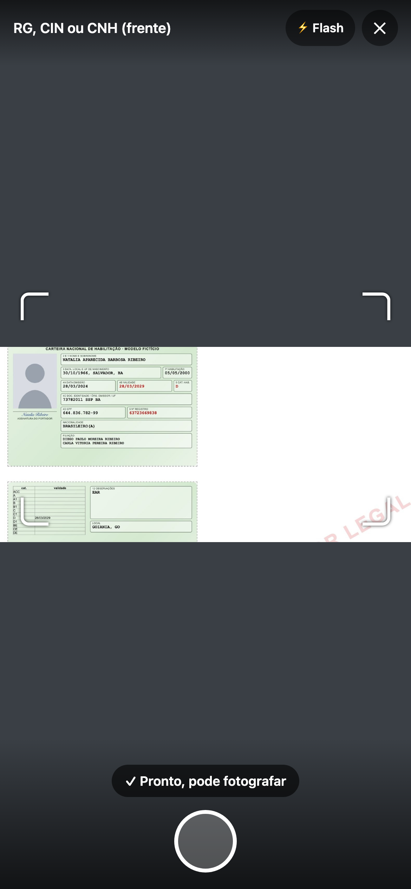</td>
    <td width="76%">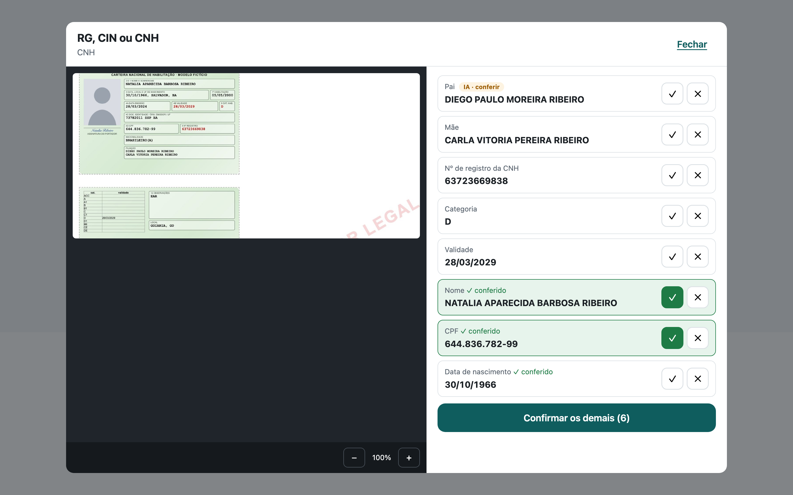</td>
  </tr>
  <tr>
    <td align="center"><sub>Celular do cliente</sub></td>
    <td align="center"><sub>Revisão no escritório: foto ao lado dos dados</sub></td>
  </tr>
</table>

> Projeto de estudo e pesquisa, sem fins comerciais. Todos os documentos usados no desenvolvimento são fictícios.

---

## Em 30 segundos

| Tema | Resumo |
|---|---|
| **Problema** | Escritórios de direito do consumidor cadastram dezenas de clientes por dia. Os documentos chegam misturados pelo WhatsApp, são digitados à mão, e um CPF errado chega à procuração e ao processo |
| **Para quem** | A assistente de cadastro (usuária principal), o cliente que envia os documentos e a advogada que recebe o cadastro |
| **Solução** | Link de captura pelo celular, leitura automática (OCR, regras e IA local), validação por dígito verificador e revisão campo a campo com a foto ao lado |
| **Métrica que guia o produto** | Clientes cadastrados por semana **sem nenhuma edição** |
| **Onde está** | Etapas 0 a 11 de 14 concluídas: produto construído e testado no celular. Próximo: sessões com usuários reais |

---

## O problema

**Juliana** é assistente de cadastro numa advocacia de massa. Cada cliente envia RG ou CNH, um comprovante de residência e as provas da cobrança que contesta. Os seis tipos de documento aparecem **no mesmo atendimento**, misturados.

| Dor | Consequência |
|---|---|
| Digitação manual de identificação e provas | O cadastro vira gargalo, e o tempo de cadastro é cobrado como indicador |
| Documento ilegível exige novo pedido ao cliente | O cadastro espera horas ou dias pela resposta |
| Erro de leitura passa adiante | Um CPF errado se repete na procuração e no processo |

O segmento **não foi o ponto de partida**. O projeto começou com escritórios contábeis e mudou de rumo quando a pesquisa mostrou que nota fiscal e boleto já chegam por canais eletrônicos e que o cadastro contábil é pouco frequente ([Etapa 3](docs/etapas/03-validacao-do-problema.md)).

→ [Personas](docs/persona.md) · [Pesquisa e entrevistas simuladas](docs/pesquisa/entrevistas-simuladas.md)

---

## Como o produto foi pensado

Cada fase respondeu a uma pergunta antes de passar à seguinte. Toda decisão relevante ficou registrada com o motivo e as alternativas descartadas.

| Fase | Pergunta | Decisão central | Artefatos |
|---|---|---|---|
| **Descoberta** | O problema existe, e para quem? | Pivô para advocacia de consumidor de alto volume | [Hipóteses](docs/etapas/00-concepcao.md), [pesquisa](docs/etapas/03-validacao-do-problema.md), [personas](docs/persona.md) |
| **Estratégia** | Onde o produto gera valor? | O documento ilegível pode custar mais que a digitação; o cliente corrige na hora, com o documento na mão | [Visão, árvore de oportunidades, PR/FAQ, jornadas](docs/etapas/04-estrategia.md) |
| **Métricas** | Como saber se funciona? | North Star "clientes sem nenhuma edição", com métrica de proteção vinda de fora da revisão | [North Star, árvore de métricas, OKRs](docs/etapas/05-metricas.md) |
| **Priorização** | O que construir primeiro? | RICE, MVP definido, roadmap "captura primeiro" | [Backlog, RICE, DoR/DoD, roadmap](docs/etapas/06-priorizacao.md) |
| **Viabilidade** | Se fosse produto, se sustentaria? | Venda direta não se paga; o caminho é licenciar para softwares jurídicos | [Business case com dados do CNJ e do TST](docs/etapas/07-business-case.md) |
| **Arquitetura** | Como funciona, com que riscos? | Riscos técnicos testados antes de construir; um deles mudou a arquitetura | [C4](docs/arquitetura/c4.md), [provas de conceito](docs/etapas/08-arquitetura-e-poc.md), [11 decisões (ADRs)](docs/decisoes/README.md) |
| **Experiência** | Como o cliente e a assistente usam? | Wireframes aprovados antes do código; mudanças guiadas por testes no celular | [Wireframes](docs/ux/captura-wireframes.md), [guia visual](docs/ux/guia-visual.html), [telas finais](docs/ux/telas-finais.md) |
| **Construção** | O motor generaliza? | Medição honesta antes de ajustar; regras genéricas e IA local com trava contra dado inventado | [Motor de extração](docs/etapas/10-motor.md), [requisitos](docs/requisitos.md) |


**Árvore de oportunidades: do resultado às dores, soluções e experimentos**

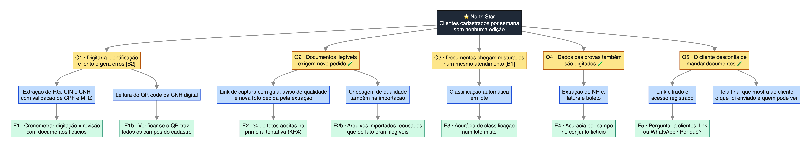

**Árvore de métricas: North Star, apoio, proteção e alavancas**

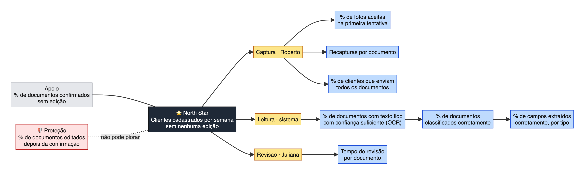

---

## Decisões que mudaram o rumo

As decisões revistas ficam lado a lado com as originais. É nelas que o projeto mais aprendeu.

| Antes | Depois | O que provocou a mudança |
|---|---|---|
| Escritório contábil | Advocacia de consumidor de alto volume | Pesquisa: os documentos já chegavam por canal eletrônico, e o cadastro era raro |
| Venda direta a escritórios | Licenciamento para softwares jurídicos | Business case: a venda direta exigiria de 14% a 28% de todo o mercado alcançável |
| As duas páginas na internet | Aplicação do escritório servida pelo computador local | Prova de conceito: o Safari bloqueia a chamada da página ao computador |
| Regras de extração por layout | Regras genéricas e IA local | Teste com layouts novos: as regras cobriam só 27% dos campos |
| Celular recusa foto com reflexo | Celular barra só o óbvio; o motor decide | Primeiro teste no celular: fotos boas eram recusadas |
| Nada fica guardado | Guardado cifrado até as 18h; só a chave no navegador | Atualizar a página perdia o cadastro do dia |

→ [Linha do tempo completa da evolução do produto](docs/evolucao.md)

---

## O produto

**No celular do cliente**, sem instalar nada: abre o link, fotografa ou importa cada documento, recebe orientação de luz e enquadramento e, se a foto não der para ler, um pedido de nova foto na hora.

**No computador do escritório:** os documentos chegam classificados e lidos; a assistente confere cada campo com a foto ao lado, o cliente confere os próprios dados no fim e o escritório baixa um pacote com os arquivos e os dados.

| | | | |
|---|---|---|---|
| 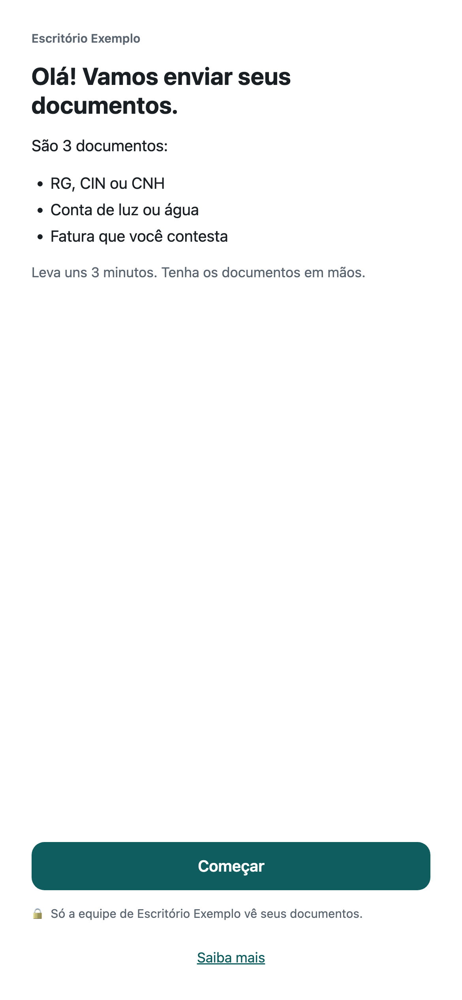<br>Abertura | 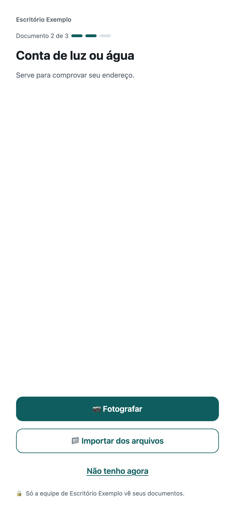<br>Documento | 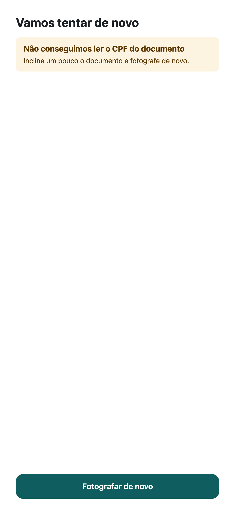<br>Nova foto pedida pelo motor | 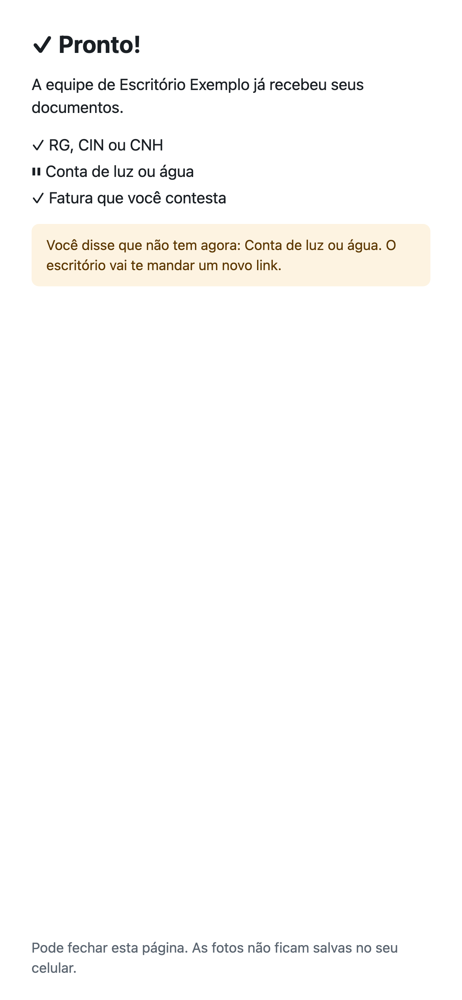<br>Envio concluído |

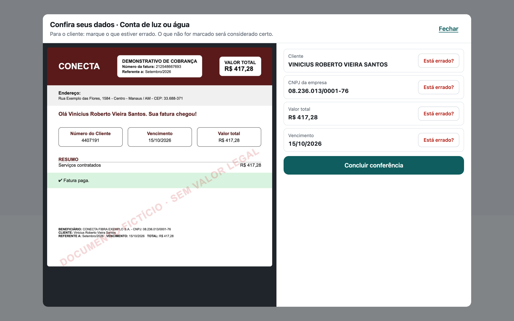

→ [Todas as telas e o que mudou entre as versões](docs/ux/telas-finais.md) · [Fluxo das telas](docs/ux/captura-wireframes.md#fluxo-das-telas) · [Fluxogramas do sistema](docs/arquitetura/fluxogramas.md)


**Fluxo das telas do celular, com as exceções**

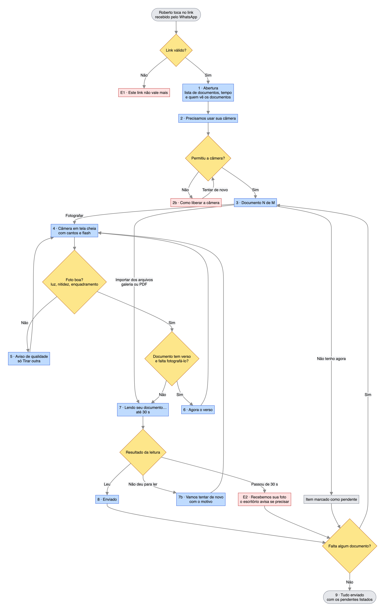

---

## Como uma sessão funciona

<p>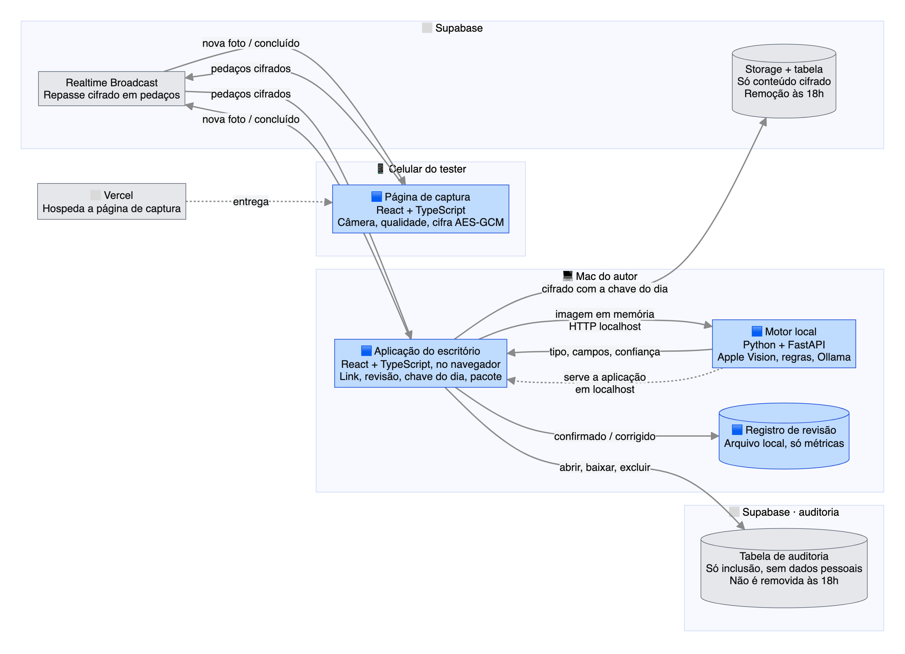</p>

1. **O escritório monta o pedido.** A assistente escolhe os documentos esperados daquele cliente. O navegador gera um **identificador de sessão** e uma **chave AES-256** aleatórios.
2. **O link carrega a chave no fragmento.** O endereço tem a forma `captura.html?s=<sessão>#k=<chave>&d=<documentos>`. O que vem depois do `#` **nunca é enviado a servidor nenhum**: nem a Vercel nem o Supabase veem a chave. O link vai por QR code ou WhatsApp.
3. **Pareamento.** O celular abre o link, apaga a chave da barra de endereço e entra no canal `sessao:<id>`. O escritório aceita **só o primeiro celular**; um link não aberto em 5 minutos expira.
4. **Captura.** O cliente fotografa ou importa cada documento. O celular checa luz e nitidez, cifra a imagem (AES-GCM) e a envia em **pedaços de 128 KB**.
5. **Leitura.** O escritório remonta e decifra a imagem e a manda ao **motor local**, que detecta a posição da foto, lê o texto (OCR), classifica o documento, extrai e valida os campos.
6. **Resposta em até 30 segundos.** Se faltar um dado essencial, o celular pede outra foto na hora, com o motivo ("Não conseguimos ler o CPF").
7. **Revisão e conferência.** A assistente confirma ou recusa cada campo com a foto ao lado; no fim, o cliente confere os próprios dados.
8. **Guarda e entrega.** O cadastro fica cifrado no Supabase até as 18h, com uma chave que só o navegador do escritório tem, e pode ser baixado como pacote (.zip).

→ [Sequência completa das mensagens](docs/arquitetura/fluxogramas.md#3-sequência-de-mensagens-no-cross-device) · [Estados da sessão](docs/arquitetura/fluxogramas.md#5-estados-da-sessão)


**Sequência de mensagens entre celular, canal, escritório e motor**

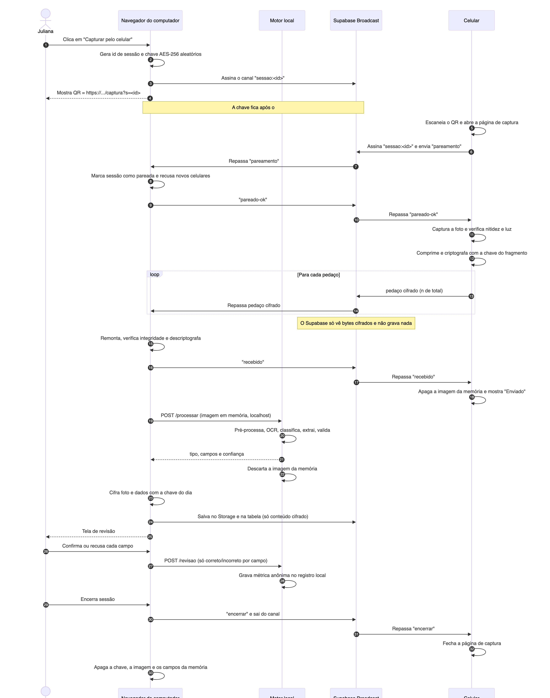

**Pipeline do motor: da imagem aos campos validados**

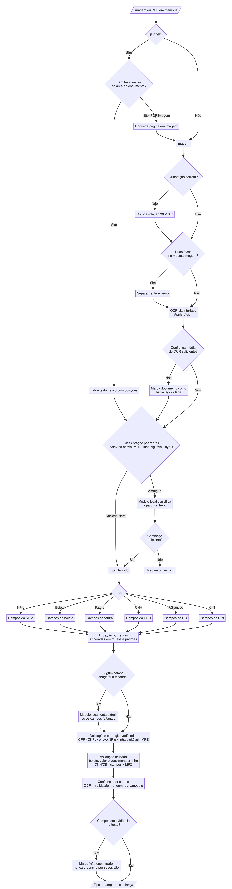

---

## Tecnologias

| Camada | Tecnologia | Papel |
|---|---|---|
| Página de captura (celular) | React 19, TypeScript, Vite | Câmera, checagem de qualidade, cifra e envio |
| Aplicação do escritório | React 19, TypeScript, servida pelo motor local | Link e QR code, revisão, conferência, pacote |
| Hospedagem da captura | Vercel | Página estática com HTTPS (exigido para usar a câmera) |
| Canal em tempo real | Supabase Realtime (Broadcast) | Repassa mensagens cifradas entre celular e computador, sem gravar |
| Banco | Supabase Postgres, Row Level Security, pg_cron | Cadastros cifrados, auditoria só de inclusão e remoção agendada |
| Motor de extração | Python, FastAPI | Orquestra OCR, regras, validação e IA |
| Leitura de texto (OCR) | Apple Vision (via PyObjC) | OCR do próprio macOS, em português, sem custo |
| IA de texto | Ollama + Qwen 2.5 7B, local | Completa campos que as regras não acharam |
| Criptografia | Web Crypto API (AES-GCM 256) | Cifra no celular e no navegador; chaves não exportáveis |
| Bibliotecas de apoio | `qrcode`, `fflate`, Pillow | QR code, pacote .zip no navegador, imagens |
| Testes | Vitest, Testing Library, pytest | 27 testes na aplicação e 10 no motor |
| Design e documentação | Figma, Mermaid | Wireframes e telas por versão; diagramas versionados no repositório |

### APIs utilizadas

| API | Para quê |
|---|---|
| **Supabase Realtime Broadcast** (WebSocket) | Pareamento, pedaços cifrados, resultado da leitura e pendências |
| **Supabase REST** (PostgREST) | Gravar e ler os cadastros cifrados e a auditoria |
| **Web Crypto** | Gerar chaves, cifrar e decifrar (AES-GCM) |
| **MediaDevices / getUserMedia** | Câmera dentro da página, com restrição de lanterna (flash) quando o aparelho oferece |
| **File API** e **IndexedDB** | Importar arquivos no celular; guardar só a chave do dia no navegador do escritório |
| **Apple Vision** (`VNRecognizeTextRequest`) | Leitura de texto nas fotos e PDFs |
| **Ollama** (`/api/chat` com esquema JSON) | IA local, em `localhost`, com resposta estruturada |
| **Motor local** (`POST /processar`, `POST /revisao`) | Leitura dos documentos e registro de medição, só no próprio computador |

---

## Custo do estudo: perto de zero

O estudo foi desenhado para rodar **sem custo por documento lido**.

| Recurso | Escolha | Custo |
|---|---|---|
| Hospedagem da captura | Vercel, plano gratuito | R$ 0 |
| Canal e banco | Supabase, plano gratuito | R$ 0 |
| OCR | Apple Vision, nativo do macOS | R$ 0 |
| IA | Modelo aberto rodando no próprio Mac | R$ 0 por documento |
| Motor | O computador que já existe | R$ 0 |
| Design | Figma, plano gratuito | R$ 0 |

### Por que o motor roda no computador local

| Motivo | Explicação |
|---|---|
| **Privacidade** | Documentos de identificação de terceiros não saem do computador do escritório. Uma API de IA na nuvem receberia cada documento |
| **Custo zero por documento** | APIs de OCR e de IA cobram por página ou por chamada. Localmente, o custo é o computador que já existe |
| **Qualidade suficiente** | O Apple Vision lê português com boa precisão e já vem no macOS: o motor por regras sobre ele chegou a 95% de campos certos |
| **Velocidade** | 0,6 s por documento com regras; a IA local só entra quando falta algum campo |
| **Custo de desenvolvimento x operação** | Uma IA de visão na nuvem seria mais rápida de montar, mas teria custo recorrente e mandaria os documentos para terceiros. Ela foi comparada só com documentos fictícios ([ADR 0002](docs/decisoes/0002-motor-de-leitura-e-extracao.md)) |

**A troca:** o estudo depende de um Mac. Num produto, o motor iria para um servidor próprio na nuvem, com um OCR de código aberto (PaddleOCR) no lugar do Apple Vision, ainda sem provedores de IA de terceiros ([ADR 0010](docs/decisoes/0010-motor-em-producao.md)).

### Por que a IA é o Qwen 2.5 7B, e por que ela não lê a imagem

| Critério | Qwen 2.5 7B |
|---|---|
| Português | Bom desempenho em português, inclusive com nomes e endereços brasileiros |
| Resposta estruturada | Devolve JSON seguindo um esquema fixo (o Ollama força o formato), sem texto solto |
| Cabe no computador | ~4,7 GB, roda com folga num Mac M4 de 16 GB |
| Tempo | De 2 a 5 s por documento, dentro dos 30 s de espera do celular |
| Custo | Modelo aberto, gratuito, sem chamadas externas |

| Alternativa | Por que não |
|---|---|
| Llama 3.2 3B | Mais leve e rápido, mas erra mais em português e em campos específicos |
| Modelos maiores (13B ou mais) | Não cabem bem em 16 GB ou ficam lentos demais para o celular esperar |
| IA de visão lendo a foto direto | Mais lenta no Mac e mais propensa a inventar dados que não estão no documento |
| APIs de IA na nuvem | Mandariam documentos de terceiros para outra empresa |

**Como a IA é usada:** ela recebe **o texto lido pelo OCR, não a imagem**, e só preenche os campos que as regras deixaram em branco. Três travas evitam dado inventado: o valor precisa **aparecer no texto lido**; passa pelas **mesmas validações** das regras (CPF com dígito verificador, número de registro com 9 a 11 dígitos); e **não pode repetir** um nome já usado em outro campo de pessoa. O que vem da IA aparece marcado **"IA · conferir"** na revisão.

**Outras trocas:** o plano gratuito do Supabase documenta mensagens de até 256 KB, por isso a foto viaja em pedaços de 128 KB; o Figma gratuito limita o acesso automatizado, por isso parte das telas foi levada ao Figma pelo navegador.

---

## Resultados até aqui

Todos os números abaixo vêm de **documentos fictícios** gerados para o estudo e de testes técnicos. O resultado com pessoas e documentos reais é a Etapa 13.

### Motor de extração: a evolução

O conjunto de avaliação tem **32 documentos**: os seis tipos, em PDF e em versão para impressão, incluindo **14 com layouts que as regras não conheciam** (RG com rótulos ao lado, CIN bilíngue e no formato de app, CNH antiga sem MRZ). Cada campo extraído é comparado com um gabarito.

| Versão do motor | Conjunto | Tipo certo | Campos extraídos certos | Cobertura¹ |
|---|---|---|---|---|
| Regras v1 | 18 documentos de layout conhecido | 18 de 18 | 100% | — |
| Regras v1 | **14 de layout novo** | **6 de 14** | 82% | **27%** |
| Regras genéricas | 14 de layout novo | 12 de 14 | 95% | 72% |
| Regras genéricas + IA | 14 de layout novo | 13 de 14 | 93% | 82% |
| + detecção da posição da foto | **todos os 32** | **31 de 32** | **95%** | **89%** |

¹ Cobertura: dos campos que o documento tem e que o motor se propõe a extrair, quantos ele encontrou **e** acertou. É a medida mais exigente: um campo não encontrado conta contra.

**O que a tabela conta:** o primeiro 100% estava errado. As regras tinham sido escritas olhando os mesmos documentos em que eram medidas. O número honesto (27%) só apareceu com layouts novos, e cada melhoria seguinte foi medida contra ele ([Etapa 10](docs/etapas/10-motor.md)).

### Motor de extração: por tipo de documento (versão atual, 32 documentos)

| Tipo | Campos extraídos certos | Cobertura | Onde ainda erra |
|---|---|---|---|
| Boleto | 100% (10 de 10) | 100% | — |
| Nota fiscal (NF-e) | 100% (8 de 8) | 100% | — |
| Fatura de serviço | 100% (8 de 8) | 100% | — |
| RG antigo | 99% (75 de 76) | 88% | Filiação em layouts sem rótulo; versões de impressão com texto pequeno |
| CIN | 95% (74 de 78) | 92% | Ordem pai/mãe quando o documento não diz quem é quem |
| CNH | 89% (51 de 57) | 81% | CNH antiga sem MRZ, que é o que confere nome e data de nascimento |

Os documentos com **dígito verificador** (CPF, CNPJ, chave da NF-e, linha digitável do boleto, MRZ) são os mais confiáveis: quando o motor erra a leitura, a validação percebe sozinha. Os mais frágeis são nomes e filiação, que não têm conferência automática. Por isso eles aparecem primeiro na revisão.

### Desempenho

| Medida | Resultado |
|---|---|
| Leitura por regras (OCR + extração) | **0,6 s** por documento, em média |
| Leitura com IA, quando as regras não acham tudo | **2,8 s** em média; pico de 11 s |
| Limite de espera no celular | 30 s, com folga |
| Envio de uma foto de 2 MB, cifrada, em pedaços | **menos de 0,5 s** ([prova de conceito](docs/etapas/08-arquitetura-e-poc.md)) |
| Detecção da posição da foto | **8 de 8** rotações (0°, 90°, 180° e 270°, em CNH e fatura) |

### Testes com o produto

| Teste | O que mostrou | O que mudou |
|---|---|---|
| 1º teste no celular | Fotos boas da tela eram recusadas como "reflexo" | Celular barra só o óbvio; aceita a 3ª tentativa |
| 2º teste no celular | Leitura correta; chave da NF-e quebrava o layout; moldura da câmera pequena | Formatação brasileira; câmera em tela cheia |
| Teste com RG de modelo novo | Documento não reconhecido | Regras genéricas + IA |
| Foto de cabeça para baixo | Leitura correta, mas foto virada na revisão | Detecção automática da posição e botão "Girar" |
| Atualizar a página | Cadastro perdido | Guarda cifrada até as 18h; teste bem-sucedido |

**Qualidade do código:** 27 testes automatizados na aplicação e 10 no motor, cobrindo o protocolo cifrado, o fluxo das telas, a qualidade da foto, a leitura de PDF, a rotação, a formatação, o pacote do cliente e o relatório dos resultados-chave.

---|---|
| Cobertura do motor em layouts nunca vistos | **27%** com as primeiras regras → **82%** com regras genéricas e IA |
| Campos extraídos corretos (32 documentos) | **95%**, com cobertura de **89%** |
| Classificação do tipo de documento | 31 de 32 |
| Detecção da posição da foto | 8 de 8 rotações |
| Envio de uma foto de 2 MB, cifrada, do celular ao computador | menos de 0,5 s |
| Testes automatizados | 27 na aplicação e 10 no motor |

O primeiro número do motor foi 100%, e ele estava errado: as regras tinham sido escritas olhando os mesmos documentos em que eram medidas. O número honesto veio de documentos com layouts novos, e as melhorias partiram dele ([Etapa 10](docs/etapas/10-motor.md)).

---

## Privacidade por desenho

| Princípio | Como se aplica |
|---|---|
| O servidor não lê os documentos | A captura é cifrada no celular; o que fica guardado é cifrado com uma chave que só o navegador do escritório tem |
| Nada sobrevive ao dia (no estudo) | Remoção às 18h em três camadas independentes: destruição da chave, tarefa agendada no banco e limite de 24h |
| A IA não sai do computador | OCR e IA rodam localmente; nenhum documento vai para provedores de IA |
| A IA não inventa dados | Todo valor sugerido pela IA precisa aparecer no texto lido; o que vem dela é marcado para conferência |
| Registros sem dados pessoais | Medição e auditoria guardam só eventos, códigos e tempos; o banco recusa texto livre |
| Quem revisa não confere | A métrica de proteção vem do cliente, não de quem fez a revisão |

### Segurança: estudo de caso × produção

O estudo constrói uma versão mais restritiva e mais barata; a produção foi desenhada, mas não construída ([ADR 0008](docs/decisoes/0008-armazenamento-em-producao.md), [ADR 0010](docs/decisoes/0010-motor-em-producao.md)).

| Camada | Estudo de caso (construído) | Produção (desenho de referência) |
|---|---|---|
| Transporte celular → computador | Cifra ponta a ponta (AES-GCM), chave no fragmento do link | Igual |
| Armazenamento | Cifrado com a **chave do dia**, que só o navegador do escritório tem; o servidor não lê | Cifrado em repouso pelo provedor e por **envelope, com chave por escritório** num cofre de chaves (KMS) |
| Quem consegue ler | Só o navegador que gerou a chave | Usuários autorizados do escritório, via aplicação |
| Retenção | **Tudo removido às 18h** em três camadas; nada passa de 24h | Prazo definido pelo escritório, com exclusão automática e a pedido do titular (LGPD) |
| Acesso | Perfil simulado, sem login | Login com perfis (assistente, advogada, administrador) e segundo fator |
| Isolamento | Uma estação por vez | Row Level Security e chaves separadas por escritório |
| Auditoria | Abrir, baixar e excluir, só com códigos; tabela só de inclusão | Todos os acessos, com prestação de contas |
| Motor e IA | No Mac do escritório; nada sai do computador | Servidor próprio na nuvem (PaddleOCR + modelo aberto); sem provedores de IA de terceiros |
| Backups | Ilegíveis depois que a chave do dia é destruída | Cifrados, com prazo próprio |

**A principal troca:** em produção, o operador do sistema passa a conseguir ler os documentos, sob controle de acesso e auditoria. É o preço de permitir várias pessoas no mesmo cadastro e de não perder documentos se uma chave se perder.


**Onde o documento existe: em aberto, cifrado e nunca**

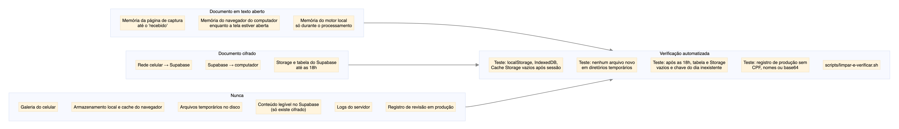

**Remoção diária às 18h em três camadas**

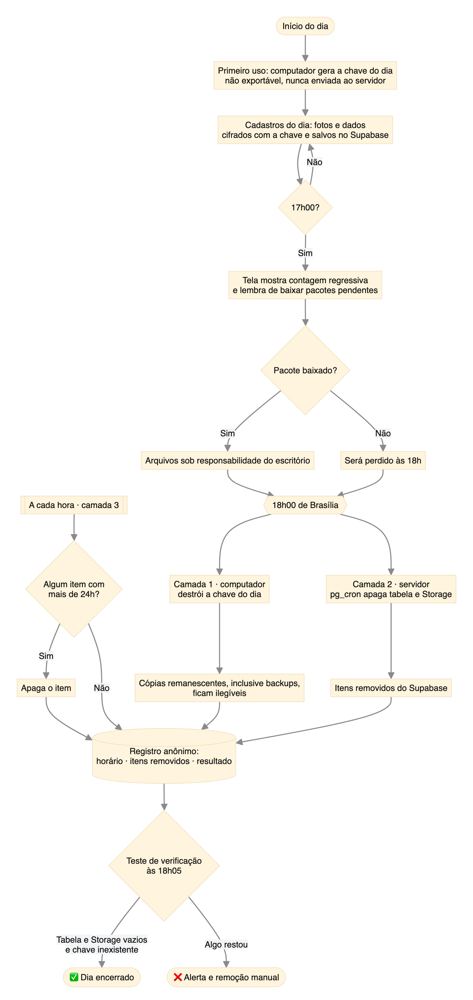

---

## Se fosse um produto

Business case **hipotético**, construído com dados públicos ([Etapa 7](docs/etapas/07-business-case.md)).

| Pergunta | Resposta |
|---|---|
| Quanto vale para o escritório? | Cerca de 8 minutos poupados por cadastro, ou ~R$ 4 com o custo da hora de uma assistente. Hipótese a medir nas sessões |
| Quanto custaria operar? | ~R$ 28 mil por mês: duas pessoas e servidores |
| Qual o tamanho do mercado? | De 2 a 4 milhões de ações de consumidor por ano ([CNJ](https://www.cnj.jus.br/judiciario-inicia-2026-com-o-menor-estoque-de-processos-pendentes-em-seis-anos/)); metade com advogado |
| Venda direta se paga? | **Não.** Com preço pelo valor gerado (de R$ 149 a R$ 2.990 por mês, em quatro faixas), exigiria de 14% a 28% do mercado alcançável |
| Qual o caminho? | **Licenciar para softwares jurídicos**, como componente: R$ 40 mil por ano por parceiro mais R$ 0,30 por cadastro. Com cerca de 8 parceiros, a parte fixa cobre o custo |
| Quem decide a compra? | O líder de produto do software parceiro; o encarregado de dados pode vetar |
| Maior risco | Ciclo de venda longo: parceiros exigem prova de acurácia e de segurança antes de assinar |

O produto seria **parceiro** dos softwares de gestão jurídica, e não concorrente: o cadastro alimenta o sistema que o escritório já usa.


**Stakeholders: quem decide a compra e quem pode vetar**

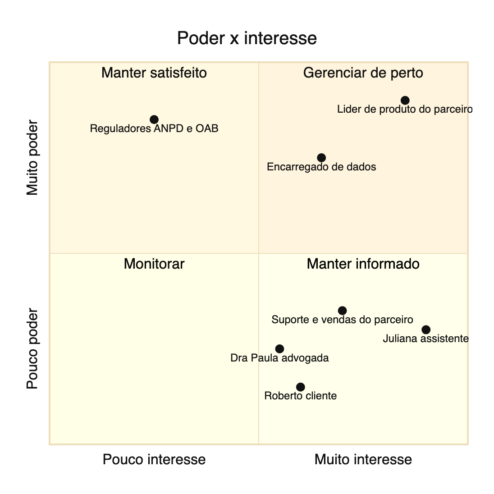

**Arquitetura de produção (C4, contêineres)**

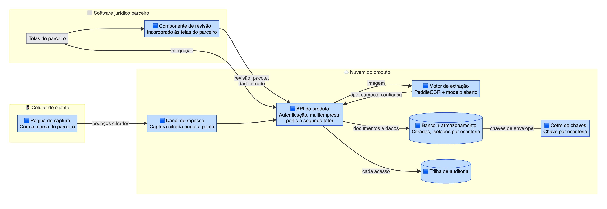

---

## Próximos passos

1. **Linha de base com fotos de documentos impressos** e metas dos resultados-chave **congeladas antes** das sessões, para a régua não se ajustar ao resultado.
2. **Qualidade:** testes de ponta a ponta e de privacidade automatizados.
3. **Sessões com usuários:** a pessoa fotografa os próprios documentos e confere os dados.
4. **Retrospectiva:** resultados finais e aprendizados.

| # | Etapa | Situação |
|---|---|---|
| 0–8 | Concepção, documentos e campos, requisitos, validação, estratégia, métricas, priorização, business case, arquitetura e provas de conceito | ✅ |
| 9 | Captura pelo celular | ✅ testada |
| 10 | Motor de extração | ✅ |
| 11 | Revisão, conferência, pacote, armazenamento cifrado e auditoria | ✅ testada |
| 12 | Qualidade | ⚪ |
| 13 | Avaliação com usuários | ⚪ |
| 14 | Lançamento e retrospectiva | ⚪ |

---

## Mapa do repositório

| Onde | O quê |
|---|---|
| [`docs/etapas/`](docs/etapas/) | Uma nota por etapa, na ordem em que aconteceu |
| [`docs/decisoes/`](docs/decisoes/) | Decisões de arquitetura e produto (ADRs), com alternativas e consequências |
| [`docs/requisitos.md`](docs/requisitos.md) | Histórias de usuário, requisitos e critérios de aceite |
| [`docs/arquitetura/`](docs/arquitetura/) | C4 e fluxogramas, com imagens |
| [`docs/ux/`](docs/ux/) | Wireframes, guia visual, telas por versão |
| [`docs/evolucao.md`](docs/evolucao.md) | Linha do tempo das decisões e dos números |
| [`docs/competencias.md`](docs/competencias.md) | O que o projeto exercita, papel a papel |
| [`app/`](app/) | Página de captura (celular) e aplicação do escritório: React e TypeScript |
| [`src/`](src/) | Motor local: OCR (Apple Vision), classificação, extração, validação e IA (Ollama) |
| [`supabase/`](supabase/) | Banco: armazenamento cifrado, auditoria e remoção agendada |
| [`scripts/`](scripts/) | Documentos fictícios, avaliação do motor, relatório dos resultados-chave e imagens dos diagramas |
| [`tests/`](tests/), `app/src/**/*.test.ts` | Testes automatizados, rodados também pela integração contínua (GitHub Actions) |
| [`mcp/`](mcp/) | Servidor MCP: o motor como ferramentas para assistentes de IA |

### Como rodar

```bash
scripts/iniciar-motor.sh          # IA local + motor; abra http://localhost:8787
.venv/bin/python scripts/avaliar.py --ia     # avaliação do motor nos documentos fictícios
.venv/bin/python scripts/relatorio.py        # resultados-chave a partir do registro de medição
```

Modo de demonstração, sem celular: `captura.html?demo=camera` e `escritorio.html?demo=revisao`.

### Com um assistente de IA

Abra o repositório no Claude Code e peça *"instale e rode o teste"*. O passo a passo que o assistente segue está em [`CLAUDE.md`](CLAUDE.md): dependências, IA local, testes e modo de demonstração.

### Pelo servidor MCP

O projeto tem um servidor [MCP](https://modelcontextprotocol.io) que expõe o motor como ferramentas para assistentes de IA (Claude Code, Claude Desktop e outros clientes MCP).

**Requisitos:** macOS (o OCR é o Apple Vision), Node 22 ou mais novo e o motor rodando.

```bash
python3 -m venv .venv && .venv/bin/pip install -r requirements.txt
(cd mcp && npm ci)
scripts/iniciar-motor.sh            # deixe rodando em outro terminal
```

**No Claude Code:** abra o projeto na pasta do repositório. O arquivo [`.mcp.json`](.mcp.json) já registra o servidor `extracao-documentos`; o Claude Code pergunta se você autoriza e passa a usá-lo.

**No Claude Desktop ou em outro cliente:** adicione à configuração de servidores MCP, trocando o caminho:

```json
{
  "mcpServers": {
    "extracao-documentos": {
      "command": "node",
      "args": ["/caminho/para/extracao-dados-documentos/mcp/servidor.mjs"]
    }
  }
}
```

| Ferramenta | O que faz | Exemplo de pedido |
|---|---|---|
| `estado` | Verifica se o motor e a IA local estão rodando | *"O motor está rodando?"* |
| `listar_documentos_ficticios` | Lista os documentos de teste | *"Quais documentos fictícios existem?"* |
| `ler_documento_ficticio` | Lê um documento e devolve o tipo e os campos, com origem e conferência | *"Leia a CNH fictícia 03"* |
| `avaliar_motor` | Roda a avaliação nos 32 documentos fictícios (com ou sem IA) | *"Avalie o motor com IA nos layouts novos"* |
| `resultados_chave` | Calcula os resultados-chave a partir do registro de medição | *"Mostre os resultados-chave"* |

**Segurança:** a leitura aceita **só arquivos de `data/exemplos/`** (documentos fictícios). Qualquer caminho fora dessa pasta é recusado, para que nenhum documento real passe por um assistente de IA.

---

**Marcos Pantoja** · [github.com/marcosvpantoja](https://github.com/marcosvpantoja)
