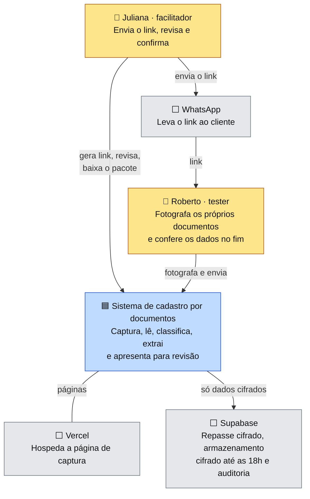
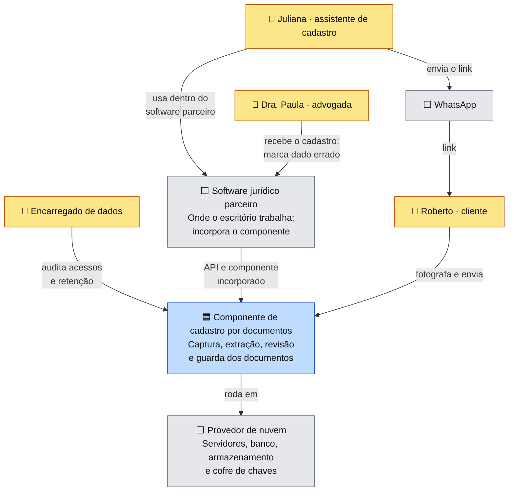
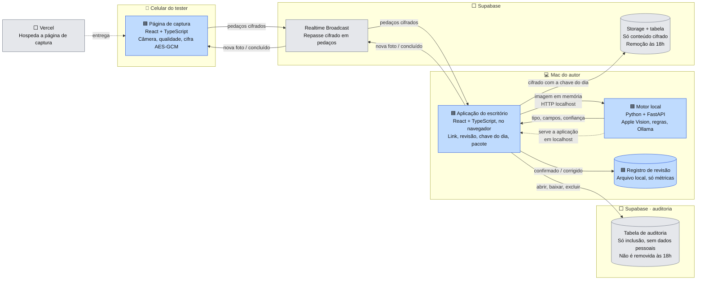
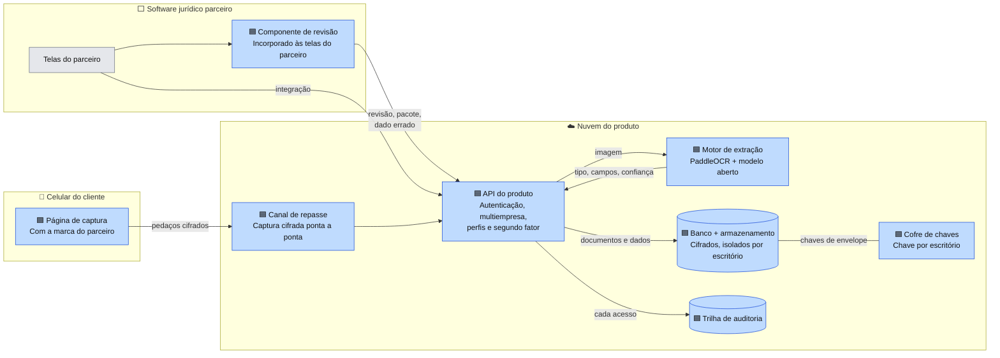

# Arquitetura em C4

O modelo C4 descreve a arquitetura em níveis de zoom. Este documento traz os dois primeiros níveis, **contexto** e **contêineres**, em duas versões lado a lado:

- **Estudo de caso:** o que é construído ([ADR 0002](../decisoes/0002-motor-de-leitura-e-extracao.md), [0005](../decisoes/0005-infraestrutura-vercel-supabase-realtime.md), [0006](../decisoes/0006-ocr-apple-vision.md), [0007](../decisoes/0007-retencao-temporaria-e-purga-diaria.md) e [0009](../decisoes/0009-registro-de-auditoria-no-estudo.md)).
- **Produção:** o desenho de referência do produto, licenciado como componente para softwares jurídicos ([ADR 0008](../decisoes/0008-armazenamento-em-producao.md), [ADR 0010](../decisoes/0010-motor-em-producao.md) e [Etapa 7](../etapas/07-business-case.md#4-go-to-market-licenciamento-para-softwares-jurídicos)).

O terceiro nível, **componentes**, será desenhado depois da prova de conceito da [Etapa 8](../../README.md#roteiro).

**Legenda:** 🧑 pessoa · 🟦 sistema ou contêiner do produto · ⬜ sistema externo

---

## 1. Contexto · estudo de caso

Quem usa o sistema e com quais sistemas externos ele conversa.

🖼️ [Ver como imagem](img/c4-01-contexto-estudo-de-caso.png)

## 2. Contexto · produção

🖼️ [Ver como imagem](img/c4-02-contexto-producao.png)

### O que muda do estudo para a produção

| | Estudo | Produção |
|---|---|---|
| Onde a Juliana trabalha | Na página do próprio sistema | Dentro do software jurídico parceiro |
| Quem compra | — | O software parceiro |
| Novos atores | — | Dra. Paula (marca dado errado) e encarregado de dados (audita) |
| Infraestrutura | Vercel, Supabase e o Mac do autor | Provedor de nuvem, com servidor do motor e cofre de chaves |

---

## 3. Contêineres · estudo de caso

Contêineres são as partes que rodam separadamente: aplicações, bancos e serviços.

🖼️ [Ver como imagem](img/c4-03-conteineres-estudo-de-caso.png)

## 4. Contêineres · produção

🖼️ [Ver como imagem](img/c4-04-conteineres-producao.png)

### O que muda nos contêineres

| Contêiner | Estudo | Produção |
|---|---|---|
| Motor | No Mac, com Apple Vision | Servidor próprio, com PaddleOCR ([ADR 0010](../decisoes/0010-motor-em-producao.md)) |
| Revisão | Aplicação própria no navegador | Componente dentro do software parceiro |
| Armazenamento | Cifrado com a chave do dia, removido às 18h | Cifrado com chave por escritório, pelo prazo definido |
| Chaves | No navegador do escritório | Cofre de chaves (KMS) |
| Autenticação | Perfil simulado | Login com perfis e segundo fator |
| Novo | — | API do produto, que concentra regras, isolamento entre escritórios e auditoria |

**Mudança depois da prova de conceito 2:** o Safari bloqueia uma página da internet chamando o motor no Mac. Por isso, no estudo, a aplicação do escritório é servida pelo próprio motor, em `localhost`, e a Vercel hospeda só a página de captura ([ADR 0011](../decisoes/0011-aplicacao-do-escritorio-servida-pelo-motor.md)). Em produção o problema não existe, porque o motor fica na nuvem.
