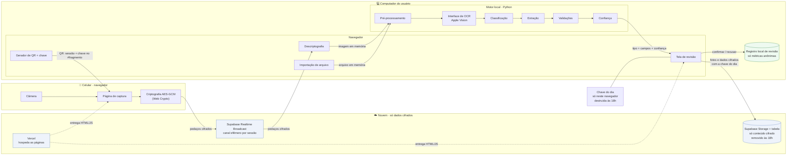
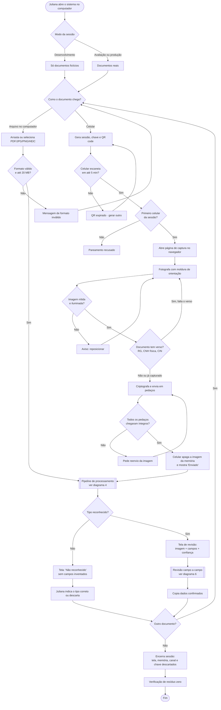
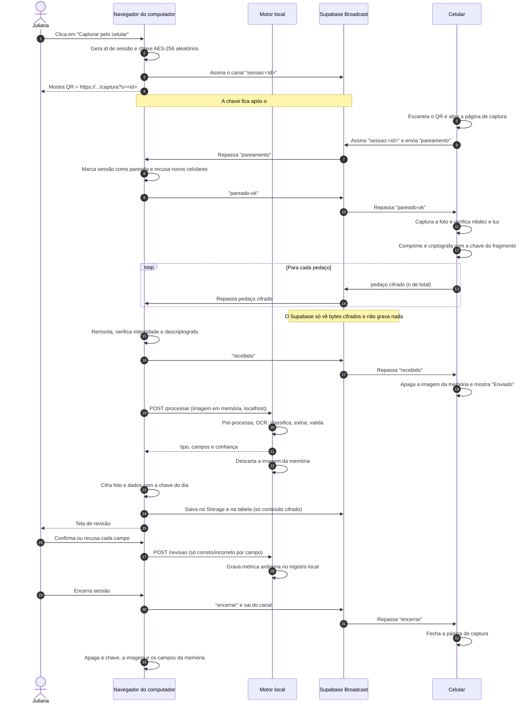
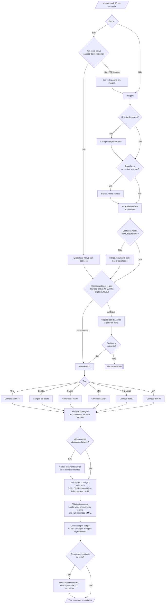
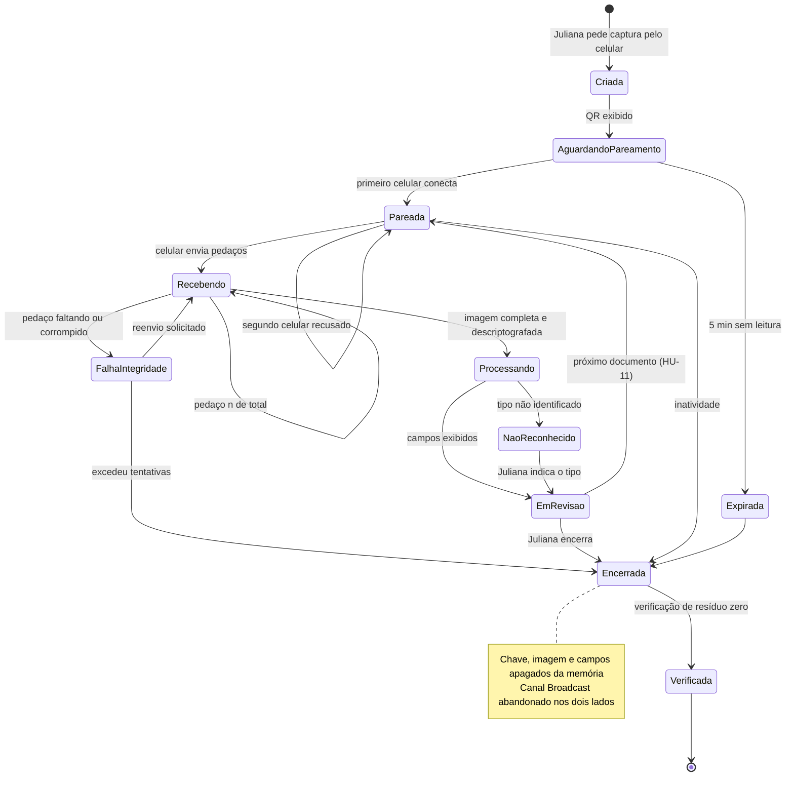
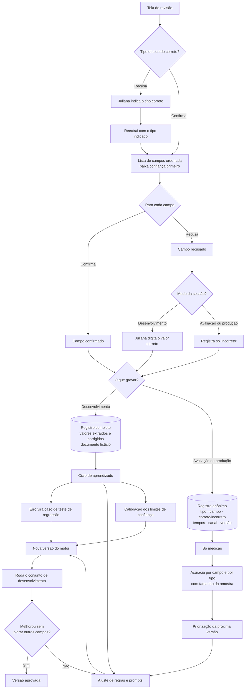
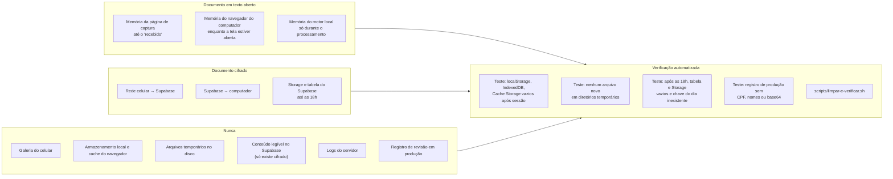
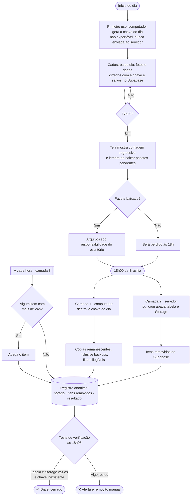

# Fluxogramas do sistema

O mesmo sistema visto em oito arranjos diferentes: componentes, jornada, sequência de mensagens, pipeline de processamento, estados da sessão, revisão e aprendizado, garantias de privacidade e remoção diária.

Base: [requisitos](../requisitos.md) e [ADRs](../decisoes/README.md).

---

## 1. Componentes e fronteiras de confiança

Quem fala com quem, e onde o documento existe em texto aberto.

🖼️ [Ver como imagem](img/fluxogramas-01-componentes-e-fronteiras-de-confianca.png)

---

## 2. Jornada completa do usuário

Os dois canais de entrada convergem no mesmo pipeline e na mesma tela de revisão.

🖼️ [Ver como imagem](img/fluxogramas-02-jornada-completa-do-usuario.png)

---

## 3. Sequência de mensagens no cross-device

O que cada parte envia, em ordem, e o que cada uma consegue ler.

🖼️ [Ver como imagem](img/fluxogramas-03-sequencia-de-mensagens-no-cross-device.png)

---

## 4. Pipeline de processamento

Do arquivo bruto aos campos com confiança. Cada losango é uma decisão automática.

🖼️ [Ver como imagem](img/fluxogramas-04-pipeline-de-processamento.png)

---

## 5. Estados da sessão

Ciclo de vida de uma sessão cross-device, incluindo falhas.

🖼️ [Ver como imagem](img/fluxogramas-05-estados-da-sessao.png)

---

## 6. Revisão humana e ciclo de aprendizado

O que acontece com cada confirmação ou recusa, conforme o modo ([ADR 0004](../decisoes/0004-revisao-humana-e-ciclo-de-aprendizado.md)).

🖼️ [Ver como imagem](img/fluxogramas-06-revisao-humana-e-ciclo-de-aprendizado.png)

---

## 7. Garantias de privacidade: onde o documento existe

Cada lugar por onde o documento passa, por quanto tempo e como isso é verificado.

🖼️ [Ver como imagem](img/fluxogramas-07-garantias-de-privacidade-onde-o-documento-existe.png)

---

## 8. Remoção diária às 18h

As três camadas independentes de remoção ([ADR 0007](../decisoes/0007-retencao-temporaria-e-purga-diaria.md)).

🖼️ [Ver como imagem](img/fluxogramas-08-remocao-diaria-as-18h.png)
