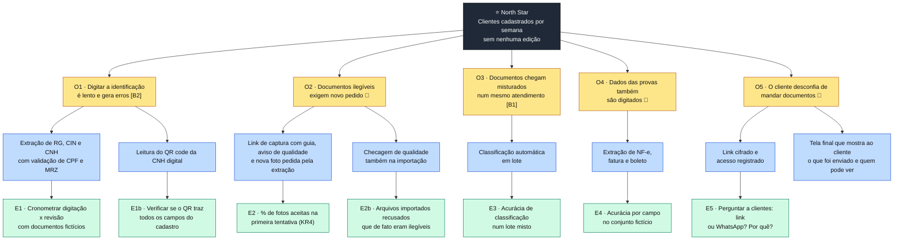

# Etapa 4: Estratégia e mapeamento de oportunidades

**Status:** ✅ Concluída · 10/11/2026 · revisada em 11/11/2026 (visão, princípios, árvore, PR/FAQ e jornadas)
**Papéis:** PM, UX
**Entradas:** [Etapa 3](03-validacao-do-problema.md), [Personas 3.0](../persona.md), [PRD](../requisitos.md)

Esta etapa responde **por que** o produto existe e **onde** ele gera valor, antes de detalhar o **como**. Ela tem quatro artefatos: visão, Opportunity Solution Tree, PR/FAQ e mapa de jornada.

As afirmações seguem as marcações das personas: **[A1]–[B4]** indicam achados da pesquisa pública e **🧪** indica hipótese a validar nas entrevistas da Etapa 3.

---

## 1. Visão

> **Para** escritórios de direito do consumidor que cadastram muitos clientes por dia,
> **que** perdem tempo digitando documentos e pagam caro por um erro que chega ao processo,
> **o produto** é um cadastro por documentos que identifica, lê e confere os dados sozinho,
> **e que**, diferente do cadastro por foto de um documento por vez, cobre identificação, comprovante e provas num único atendimento, feito pelo próprio cliente no celular, sem instalar nada,
> **com** dados conferidos antes de chegar à equipe jurídica.

**Em uma frase:** cadastrar um cliente completo, de forma ágil e precisa, sem digitar e com os dados conferidos.

A visão, o PR/FAQ e os mapas de jornada descrevem o **produto em produção** ([ADR 0008](../decisoes/0008-armazenamento-em-producao.md)). A remoção às 18h é uma regra do estudo de caso ([ADR 0007](../decisoes/0007-retencao-temporaria-e-purga-diaria.md)) e não aparece como promessa ao cliente.

### Princípios de produto

| Princípio | O que significa na prática | Decisão que ele já orientou |
|---|---|---|
| **Revisão humana sempre** | O sistema sugere e a pessoa confirma. Nenhum dado vai adiante sem confirmação | [ADR 0004](../decisoes/0004-revisao-humana-e-ciclo-de-aprendizado.md) |
| **Conferir antes de mostrar** | Todo campo com dígito verificador (CPF, chave da NF-e, linha digitável, MRZ) é validado antes da revisão | [Validadores](../../src/extracao/validacoes.py) |
| **Proteção do início ao fim** | A captura é cifrada ponta a ponta; o armazenamento é cifrado e cada acesso fica registrado | [ADR 0001](../decisoes/0001-transporte-cross-device.md), [ADR 0008](../decisoes/0008-armazenamento-em-producao.md) |
| **Sem instalar nada** | O cliente usa a câmera pelo navegador, a partir de um link | RF-04, HU-14 |
| **Recusar é melhor que errar** | Diante da dúvida, o sistema marca "não reconhecido" em vez de inventar um valor | RF-10, RF-15 |
| **Corrigir na origem** | Problema de captura se resolve com o cliente ainda com o documento na mão, e não depois, com um novo pedido | RF-31 |
| **Quem faz não confere** | Toda medição de qualidade vem de alguém de fora de quem executou | [Métrica de proteção e conferência pelo tester](05-metricas.md#2-métrica-de-proteção) |

### O que o produto não é

| Não é | Por quê |
|---|---|
| Software de gestão jurídica | O cadastro alimenta essas ferramentas; não as substitui **[B4]** |
| Verificação de identidade (KYC) | Não faz biometria nem prova de vida; esse mercado já é atendido **[A4]** |
| Gestão eletrônica de documentos | Guarda os documentos do cadastro, mas não organiza processos nem peças; isso é papel do software jurídico |
| Leitor de qualquer documento | Seis tipos, escolhidos por aparecerem no mesmo atendimento **[B1]** |

---

## 2. Opportunity Solution Tree

A árvore (Teresa Torres, *Continuous Discovery Habits*) parte de **um resultado mensurável**, abre as **oportunidades** (dores e necessidades do usuário, não funcionalidades), liga cada oportunidade a **soluções** possíveis e cada solução a um **experimento** que testa a hipótese mais arriscada.

**Resultado:** a North Star, **clientes cadastrados por semana sem nenhuma edição** ([Etapa 5](05-metricas.md#1-north-star)). A primeira versão da árvore usava "menos tempo de cadastro, sem mais erros devolvidos", escrita antes da North Star; a raiz foi alinhada para árvore e métricas falarem a mesma língua.

🖼️ [Ver como imagem](img/04-estrategia-01-opportunity-solution-tree.png)

### Oportunidades comparadas

| Oportunidade | Impacto no resultado | Evidência | Coberta pelo MVP? | Hipótese mais arriscada |
|---|---|---|---|---|
| **O1** Digitar identificação | Alto: está em todo cadastro | **[B2]** | Sim | Revisar campos extraídos é de fato mais rápido que digitar |
| **O2** Documentos ilegíveis | Alto: cada novo pedido pode custar horas ou dias de espera 🧪 | 🧪 | Sim (captura: RF-05 e RF-31; importação: RF-32) | É uma dor frequente; não sabemos quantas vezes por dia acontece |
| **O3** Documentos misturados | Médio: separar leva segundos para um humano | **[B1]** | Sim | A classificação erra pouco o suficiente para não atrapalhar |
| **O4** Dados das provas | Médio: menos campos que a identificação 🧪 | 🧪 | Sim | O escritório cadastra esses dados no início, e não só na petição |
| **O5** Desconfiança do cliente | Baixo no tempo, alto na adoção | 🧪 | Sim | O cliente troca o hábito do WhatsApp por um link |

### O que a árvore revelou

1. **O2 pode valer mais que O3.** Separar documentos é rápido para um humano. Pedir de novo um documento ilegível pode travar o cadastro até o cliente responder. Se as entrevistas confirmarem a frequência, o aviso de qualidade deixa de ser detalhe (RF-05) e vira diferencial, e precisa existir também na importação. Na revisão desta etapa, a nova foto pedida pela extração (RF-31) e a checagem na importação (S2b, RF-32) entraram no MVP.
2. **O5 é risco de adoção, não de tempo.** O cliente já manda tudo pelo WhatsApp. O link de captura só funciona se for mais fácil, ou mais confiável, que o hábito atual. Por isso a importação continua indispensável: ela recebe os arquivos que chegam pelo WhatsApp.
3. **S1b é uma alternativa barata a testar.** O QR code da CNH digital traz dados assinados que dispensariam OCR. Se trouxer todos os campos do cadastro (E1b), a CNH digital vira o tipo mais preciso do conjunto.

---

## 3. PR/FAQ

Formato da Amazon (*Working Backwards*): a comunicação de lançamento é escrita **antes** de construir, para testar se o valor se sustenta em linguagem de cliente. O texto abaixo é **hipotético** e usa um escritório fictício.

### Comunicado

> **Escritórios de direito do consumidor passam a cadastrar clientes completos em uma única interação, sem digitar**
>
> *Identificação, comprovante de residência e provas do caso são lidos, conferidos e separados automaticamente, com os documentos protegidos do celular ao arquivo*
>
> Um escritório de advocacia de massa recebe dezenas de clientes por dia. Cada um envia RG ou CNH, uma conta de luz e as provas da cobrança que contesta: notas fiscais, faturas e boletos. Hoje, uma assistente digita esses dados, documento por documento, e um CPF errado na procuração volta da equipe jurídica ou chega ao processo.
>
> Com o novo cadastro por documentos, a assistente envia ao cliente um link. Ele fotografa os documentos com o celular, sem instalar nada, e os dados aparecem no computador do escritório já separados por tipo e conferidos: CPF, chave da nota fiscal e linha digitável do boleto passam por validação antes de chegar à tela. Se uma foto não permite ler os dados, o próprio celular pede outra na hora, enquanto o cliente ainda está com o documento na mão. A assistente só confirma ou corrige cada campo. Arquivos recebidos pelo WhatsApp podem ser importados da mesma forma, e o sistema avisa na hora se algum estiver ilegível.
>
> Os documentos trafegam cifrados de ponta a ponta e ficam guardados cifrados, com uma chave exclusiva de cada escritório. Só pessoas autorizadas acessam, cada acesso é registrado, e os documentos são apagados automaticamente no prazo que o escritório definir.
>
> *"Antes, um RG com reflexo me fazia esperar o cliente até o dia seguinte. Agora o próprio celular pede outra foto na hora, e eu só confiro o que o sistema marca em dúvida"*, diz Juliana, assistente de cadastro de um escritório fictício usado no estudo.

### Perguntas do cliente

| Pergunta | Resposta |
|---|---|
| Preciso escolher o tipo de documento? | Não. O sistema identifica sozinho entre NF-e, boleto, fatura de serviço, CNH, RG antigo e CIN. |
| O cliente precisa instalar um aplicativo? | Não. O link abre a câmera no navegador do celular. |
| E se a foto ficar ruim? | A página de captura avisa antes do envio. Se mesmo assim o sistema não conseguir ler os dados, o celular pede uma nova foto em até 30 segundos (RF-05, RF-31). |
| E se o arquivo enviado pelo WhatsApp estiver ilegível? | O sistema avisa na hora da importação, antes da revisão, para a assistente pedir outro ao cliente (RF-32). |
| O sistema pode errar? | Pode. Por isso nada segue sem a confirmação de uma pessoa, e os campos com dígito verificador são conferidos antes. |
| Onde ficam os documentos? | Cifrados na nuvem, com uma chave exclusiva do escritório. Só usuários autorizados acessam, e cada acesso fica registrado. |
| Por quanto tempo ficam guardados? | Pelo prazo que o escritório definir. Depois são apagados automaticamente, e o cliente pode pedir a exclusão a qualquer momento (LGPD). |

### Perguntas internas

| Pergunta | Resposta |
|---|---|
| Por que agora? | Leitura de texto local (Apple Vision) e modelos de linguagem que rodam num notebook tornaram viável extrair dados sem enviar documentos a terceiros. |
| O que precisa ser verdade? | Os quatro resultados-chave da [Etapa 5](05-metricas.md#5-okrs-do-estudo): dados certos na conferência (KR1), documentos confirmados sem edição (KR2), cadastro mais rápido que a digitação manual (KR3) e fotos aceitas na primeira tentativa (KR4). E, fora do estudo, que o cliente aceite o link no lugar do WhatsApp (E5). |
| Qual o maior risco técnico? | A página na nuvem conversar com o motor local, e o limite de tamanho das mensagens do Broadcast. Ambos vão para a prova de conceito da Etapa 8. |
| Qual o maior risco de produto? | O cadastro não ser o gargalo que a pesquisa indica: a evidência sobre tempo de cadastro ainda é indireta **[B2]**. |
| Por que não usar uma API de IA na nuvem? | Os documentos não são enviados a provedores de IA de terceiros: a leitura e a extração rodam num motor próprio. APIs de IA na nuvem só são comparadas com documentos fictícios ([ADR 0002](../decisoes/0002-motor-de-leitura-e-extracao.md)). |
| O que fica de fora? | Documentos trabalhistas, outros tipos, histórico, integração com software jurídico e modo offline ([ADR 0003](../decisoes/0003-escopo-do-mvp.md)). |

---

## 4. Mapa de jornada

O mapa mostra a jornada **atual** (sem o produto), com ações, pensamentos, emoções e dores em cada fase, e as oportunidades da árvore que cada dor revela. Emoções, tempos e dores são hipóteses 🧪, ilustradas pelas [entrevistas simuladas](../pesquisa/entrevistas-simuladas.md), que não são evidência.

### Juliana, assistente de cadastro

| Fase | 1. Primeiro contato | 2. Pedir documentos | 3. Receber | 4. Cadastrar | 5. Corrigir | 6. Liberar |
|---|---|---|---|---|---|---|
| **Ação** | Atende o cliente e entende o caso | Lista os documentos pelo WhatsApp | Recebe fotos e PDFs misturados, em várias mensagens | Abre cada arquivo e digita os dados no software jurídico | Pede um novo documento ou devolve um erro apontado pelo jurídico | Envia o caso à advogada |
| **Pensa** | "Mais um caso de cobrança indevida" | "Tomara que mande tudo de uma vez" | "Qual destes é o comprovante?" | "Esse 8 é um 3?" | "De novo esse CPF" | "Próximo" |
| **Emoção** | 🙂 | 😐 | 😕 | 😩 | 😠 | 🙂 |
| **Dor** | — | O cliente esquece documentos | Arquivos misturados e ilegíveis; o cadastro espera dias pelo último documento (N4) | Digitação lenta; erro de leitura; comprovante em nome de outra pessoa (N1) | Espera pelo reenvio; retrabalho | — |
| **Oportunidade** | — | O2 | O2, O3 | O1, O4 | O1, O2 | — |
| **Com o produto** | — | Envia o link de captura | Os documentos chegam separados por tipo, com qualidade conferida | Confere campos já extraídos e validados | A nova foto é pedida na hora pelo celular (RF-31); CPF validado antes | Baixa o pacote e libera |

**Momento crítico:** a fase 4 é a mais longa e a mais cobrada **[B2]**, mas a fase 5 é a mais cara, porque depende de outra pessoa responder. O produto ataca as duas, e a fase 5 é onde a hipótese O2 precisa de dados.

### Roberto, cliente consumidor

| Fase | 1. Contratar | 2. Receber o pedido | 3. Fotografar | 4. Enviar | 5. Aguardar |
|---|---|---|---|---|---|
| **Ação** | Fecha com o escritório | Recebe a lista de documentos | Procura os documentos e tira fotos | Manda pelo WhatsApp, uma foto por mensagem | Espera saber se deu certo |
| **Pensa** | "Vou recuperar meu dinheiro" | "Onde está minha conta de luz?" | "Ficou torta, serve?" | "Meu RG vai ficar no celular de quem?" | "Mandei tudo?" |
| **Emoção** | 🙂 | 😐 | 😕 | 😟 | 😐 |
| **Dor** | — | Lista confusa | Não sabe se a foto serve | Insegurança com os documentos | Não sabe se precisa reenviar |
| **Oportunidade** | — | O2 | O2 | O5 | O2 |
| **Com o produto** | — | Recebe um link com a lista | A página guia a foto, avisa se ficou ruim e pede outra se não der para ler | Envio cifrado; sabe quem terá acesso | Vê "Lendo seu documento…" e depois "Enviado" |

**Momento crítico, em dois contextos:**

| Contexto | Fase | Por quê |
|---|---|---|
| **Produto real** | 4 · Enviar | O WhatsApp é o hábito. Se o Roberto não confiar no link, nem chega a usar o produto. O link precisa ser mais simples que o WhatsApp, e a garantia de que só o escritório acessa os documentos é o que pode convencê-lo (E5) |
| **Estudo de caso** | 3 · Fotografar | O tester usa o link de qualquer jeito, então o risco da fase 4 não aparece nas sessões. O que o estudo observa é a dúvida "ficou boa? vai servir?", onde o produto mais age (RF-05, RF-31) e o KR4 mede |

### Roberto com o produto, passo a passo

A jornada abaixo mostra a captura **com o produto**, que é o foco do estudo. Cada passo corresponde a uma tela ou a um estado da página de captura e serve de base para os wireframes da [Etapa 9](../../README.md#roteiro).

| Passo | O que o Roberto faz | O que a página mostra | Pensa | Emoção | Requisito | Métrica |
|---|---|---|---|---|---|---|
| 1. Recebe o link | Toca no link enviado pelo escritório no WhatsApp | — | "É do escritório mesmo?" | 😐 | HU-13 | — |
| 2. Abre a página | Lê a lista do que precisa fotografar | Nome do escritório, lista de documentos e como os dados são protegidos | "Ok, são três documentos" | 🙂 | RF-04, HU-14 | — |
| 3. Fotografa | Enquadra o documento na moldura | Câmera com moldura e dica de luz | "Assim está bom?" | 😕 | RF-05 | — |
| 4. Recebe o aviso de qualidade | Refaz a foto, se a página pedir | "Imagem escura, tente perto de uma janela" | "Ainda bem que avisou" | 😐 | RF-05 | KR4 |
| 5. Fotografa o verso | Vira o documento, quando houver verso | "Agora o verso" | — | 😐 | — | — |
| 6. Espera a leitura | Aguarda, até 30 s | "Lendo seu documento…" com indicação de progresso | "Está carregando?" | 😐 | RF-31 | — |
| 7. Refaz, se a leitura falhar | Fotografa de novo, com o documento ainda na mão | "Não conseguimos ler o número. Tente sem reflexo" | "Melhor agora do que depois" | 😕 | RF-31 | KR4 |
| 8. Vê o envio concluído | Passa para o próximo documento | "Enviado" e o que ainda falta na lista | "Falta só um" | 🙂 | — | — |
| 9. Termina | Fecha a página | "Tudo enviado. O escritório já recebeu" | "Pronto, não preciso mandar de novo" | 😀 | — | — |

**Ponto em aberto:** se o Roberto não tiver um dos documentos em mãos no momento, a sessão de uso único (RF-03) impede que ele volte depois pelo mesmo link. As entrevistas simuladas indicam que isso é comum (N4). A decisão fica para a priorização da Etapa 6.

---

## Limitações

- **A ordem foi invertida.** Na prática, visão e árvore de oportunidades vêm antes do PRD. Aqui o PRD veio primeiro (Etapa 2) e a árvore serviu para conferi-lo. A conferência encontrou um ponto que o PRD não cobria: a checagem de qualidade na importação (S2b), que depois entrou no MVP como RF-32.
- **Oportunidades sem dados primários.** O2, O4 e O5 dependem das entrevistas. A ordem da tabela de oportunidades pode mudar depois delas.
- **Estudo e produção foram misturados na primeira versão.** A remoção às 18h, regra de proteção do estudo, chegou a aparecer como promessa ao cliente. A correção separou os dois contextos nos ADRs [0007](../decisoes/0007-retencao-temporaria-e-purga-diaria.md) e [0008](../decisoes/0008-armazenamento-em-producao.md).
- **O título pressupõe o cliente com todos os documentos em mãos.** As [entrevistas simuladas](../pesquisa/entrevistas-simuladas.md) indicam que o cadastro muitas vezes espera dias pelo último documento (N4). O título "em uma única interação" foi mantido por decisão; o achado segue para a priorização.
- **O PR/FAQ é um exercício de clareza, não uma previsão.** Os depoimentos são de personas, não de pessoas reais.

## Entregáveis

- [x] Visão, princípios de produto e o que o produto não é
- [x] Opportunity Solution Tree com resultado, oportunidades, soluções e experimentos
- [x] PR/FAQ com perguntas de clientes e internas
- [x] Mapas de jornada de Juliana e Roberto
