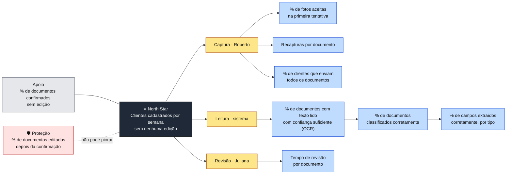

# Etapa 5: Métricas

**Status:** 🟡 Em andamento · 10/11/2026
**Papéis:** PM
**Entradas:** [Etapa 4](04-estrategia.md), [PRD, métricas de sucesso](../requisitos.md#9-métricas-de-sucesso)

As métricas desta etapa valem para o **produto em produção**, com escritórios usando o sistema todos os dias. O estudo de caso não tem uso real, então cada métrica de produção ganha uma **métrica substituta**, medida nas sessões com testers ([Etapa 13](../../README.md#roteiro)). É a mesma separação dos ADRs [0007](../decisoes/0007-retencao-temporaria-e-purga-diaria.md) e [0008](../decisoes/0008-armazenamento-em-producao.md).

---

## 1. North Star

> **Clientes cadastrados por semana sem nenhuma edição**
> Clientes cujos campos, em todos os documentos, foram confirmados na revisão sem nenhuma correção.

| Critério | Como a métrica atende |
|---|---|
| Reflete valor para o usuário | Conta clientes que saíram prontos sem a Juliana digitar nada |
| Cobre os dois atributos | **Preciso:** o sistema acertou todos os campos. **Ágil:** a revisão foi só confirmação |
| Unidade certa | O cliente, e não o documento: um cadastro com um campo corrigido ainda exigiu trabalho manual |
| Mostra uso | Por ser uma quantidade, sobe quando o produto é mais usado |
| O time influencia | Melhorar OCR, extração e captura aumenta diretamente o número |

**Limite conhecido:** a métrica é exigente. Um único campo corrigido em qualquer documento tira o cliente da conta. No início o número pode ser baixo, mas ele só sobe se o produto melhorar de verdade.

### Métrica de apoio

> **% de documentos confirmados sem edição**

A North Star mistura uso e qualidade. A métrica de apoio isola a qualidade: mostra se o sistema está acertando mais, independente do volume de clientes, e aponta em qual tipo de documento está o problema.

### Como a métrica foi escolhida

| Versão | Proposta | Por que mudou |
|---|---|---|
| 1 | Documentos importados com sucesso | "Sucesso" lido como arquivo aceito: mediria volume, sem dizer se os dados estavam certos |
| 2 | Documentos importados sem nenhuma edição | Mede o acerto de primeira, e zero edição cobre ágil e preciso ao mesmo tempo; mas a unidade era o documento e deixava de fora a captura pelo celular |
| 3 | **Clientes cadastrados sem nenhuma edição**, com % de documentos sem edição como apoio | Unidade passa a ser o cliente; a porcentagem separa qualidade de volume |

Alternativas descartadas:
- **Tempo mediano de cadastro:** mede só o ágil e dá para "melhorar" conferindo menos.
- **Clientes cadastrados em até X minutos e sem erro:** exigiria um X definido sem dados.

---

## 2. Métrica de proteção

> **% de documentos editados depois da confirmação, por qualquer perfil**

A North Star pode subir por um motivo errado: se a revisão vira um clique automático em "confirmar", as edições somem e o número melhora enquanto os erros passam adiante. A métrica de proteção não pode piorar enquanto a North Star sobe. Se piorar, a subida é falsa.

**Por que ela funciona:** vem de fora da revisão. Quem detecta o erro é outra pessoa (a advogada ou qualquer outro perfil), depois da confirmação. Um descuido de quem revisa engana a North Star, mas não engana essa métrica.

**Como o sistema fica sabendo:** a correção costuma acontecer no software jurídico, fora do produto. Por isso a tela do cadastro tem um botão **"devolver por dado errado"**: quem encontra o erro marca o campo no produto, mesmo que corrija em outro lugar (RF-30).

**Limite conhecido:** a métrica depende de a pessoa lembrar de marcar. Erros corrigidos sem marcação ficam invisíveis, então o número real tende a ser maior que o medido.

| Alternativa | Por que não foi escolhida |
|---|---|
| Documentos que precisaram de edição na revisão | Anda junto com a North Star: se a revisão vira clique automático, as duas melhoram ao mesmo tempo |
| Edição feita dentro do produto | Obriga o jurídico a trocar de ferramenta |
| Integração com o software jurídico | Fora do escopo do MVP; depende de cada fornecedor |
| Confirmações rápidas demais como alerta | Indício, não prova; não incluída nesta versão |

---

## 3. Métricas no estudo de caso

O estudo não tem escritório real, então as métricas de produção são reproduzidas nas sessões com testers ([Etapa 1](01-documentos-e-campos.md#conjunto-de-avaliação-sessões-com-testers)) e no conjunto fictício.

### Papéis na sessão

| Pessoa | Papel em produção | O que faz | Métrica que alimenta |
|---|---|---|---|
| **Tester** | Roberto, o cliente | Captura os próprios documentos pelo celular | Métricas de captura |
| **Facilitador** | Juliana, a assistente | Envia o link, revisa e confirma os campos | North Star |
| **Tester**, no fim | Jurídico | Confere os dados confirmados e aponta erros. Sabe a resposta certa porque é o dono do documento | Métrica de proteção |

A conferência fica com o tester, e não com o facilitador: quem revisou não pode conferir o próprio trabalho, senão a métrica de proteção deixa de vir de fora da revisão.

### Correspondência

| Métrica de produção | Substituta nas sessões | Substituta no conjunto fictício |
|---|---|---|
| **North Star:** clientes cadastrados sem nenhuma edição | Testers cujos documentos foram todos confirmados sem correção | Documentos de um mesmo "cliente" fictício extraídos sem nenhum campo diferente do gabarito |
| **Apoio:** % de documentos confirmados sem edição | Mesma métrica, nas sessões | % de documentos idênticos ao gabarito |
| **Proteção:** % de documentos editados depois da confirmação | % de documentos com algum campo apontado como errado pelo tester na conferência | Não se aplica: sem revisão humana, não há o que proteger |

### Limites

- **North Star otimista:** o facilitador conhece o sistema e não está sob a pressão de uma fila de clientes, então revisa com mais cuidado que a Juliana real. A substituta tende a ficar acima do valor de produção.
- **Amostra pequena:** com poucos testers, os números mostram direção, não taxas com confiança estatística. Todo resultado é reportado com o tamanho da amostra.
- **Atenção do tester:** a conferência depende de o tester olhar cada campo com cuidado.

---

## 4. Árvore de métricas

A árvore desdobra a North Star nos fatores que a fazem subir. Cada galho segue o caminho de um documento, do celular do cliente à confirmação da assistente, e cada folha é um número que o time consegue influenciar diretamente.

🖼️ [Ver como imagem](img/05-metricas-01-arvore-de-metricas.png)

### Os três galhos

| Galho | O que precisa dar certo | Observação |
|---|---|---|
| **Captura** | O cliente envia fotos legíveis de todos os documentos. Se a extração falhar por causa da imagem, o celular pede outra foto na hora, com espera de até 30 s (RF-31) | Foco principal de observação no estudo |
| **Leitura** | O texto é lido, o tipo é identificado e os campos são extraídos corretamente | Os três elos estão em sequência: se o OCR falha, a classificação e a extração falham junto |
| **Revisão** | A assistente confere os dados ao lado da foto | Tempo baixo só é bom se a métrica de proteção não piorar |

### Classificação por vários sinais

O título impresso ("Registro Geral", "Carteira Nacional de Habilitação", "DANFE") é o sinal mais forte para identificar o tipo, e por isso o texto precisa ser lido antes da classificação. Ele não basta sozinho:

- RG antigo e CIN trazem o mesmo título, "Carteira de Identidade";
- a frente do RG antigo, o lado da foto, normalmente não traz o tipo do documento;
- faturas de serviço não têm título padrão;
- um reflexo sobre o título apaga o sinal.

Por isso a classificação combina o título com outros sinais: a MRZ (presente na CIN e na CNH, ausente no RG antigo), a linha digitável do boleto e a chave de 44 dígitos da NF-e ([pipeline, diagrama 4](../arquitetura/fluxogramas.md#4-pipeline-de-processamento)).

---

## 5. OKRs do estudo

O período não é um trimestre, e sim o próprio estudo, até as sessões com testers ([Etapa 13](../../README.md#roteiro)).

> **Objetivo:** provar que um cliente pode ser cadastrado com qualidade e sem digitação, liberando o mesmo time para atender mais clientes.

| KR | Afirmação que prova | Métrica | Meta |
|---|---|---|---|
| **KR1** | Com qualidade | % de documentos sem nenhum campo apontado como errado pelo tester na conferência | A definir |
| **KR2** | Sem digitação | % de documentos confirmados sem nenhuma edição | A definir |
| **KR3** | Mais clientes com o mesmo time | Redução do tempo de cadastro por cliente em relação à digitação manual dos mesmos documentos | A definir |
| **KR4** | O cliente faz a parte dele sozinho | % de fotos aceitas na primeira tentativa | A definir |

### Como os resultados-chave foram escolhidos

| Proposta inicial | Ajuste | Motivo |
|---|---|---|
| % de fotos aceitas na primeira tentativa como prova de qualidade | Virou o KR4, da captura; a qualidade passou a ser medida na conferência (KR1) | Uma foto nítida não garante dado certo: mede a qualidade da captura, não a dos dados |
| A mesma métrica cobrindo "sem digitação" | KR2, % de documentos sem edição | Foto aceita não diz se a assistente precisou corrigir algum campo |
| Tempo de leitura e aprovação de cada sessão | KR3, com comparação contra a digitação manual | Um tempo isolado não prova ganho; precisa de referência |

**Limite do KR3:** "mais clientes com o mesmo time" é uma **projeção** feita a partir do tempo poupado por cliente, e não uma medida da capacidade de um escritório real.

**Objetivo descartado:** "a esteira de cadastro pode ser resumida em etapas com tecnologia que se aprimora com a evolução do escritório". Juntava três promessas, e a evolução com o uso não pode ser provada no estudo: o MVP não tem retreinamento ([ADR 0004](../decisoes/0004-revisao-humana-e-ciclo-de-aprendizado.md)). A ideia fica para depois do MVP.
