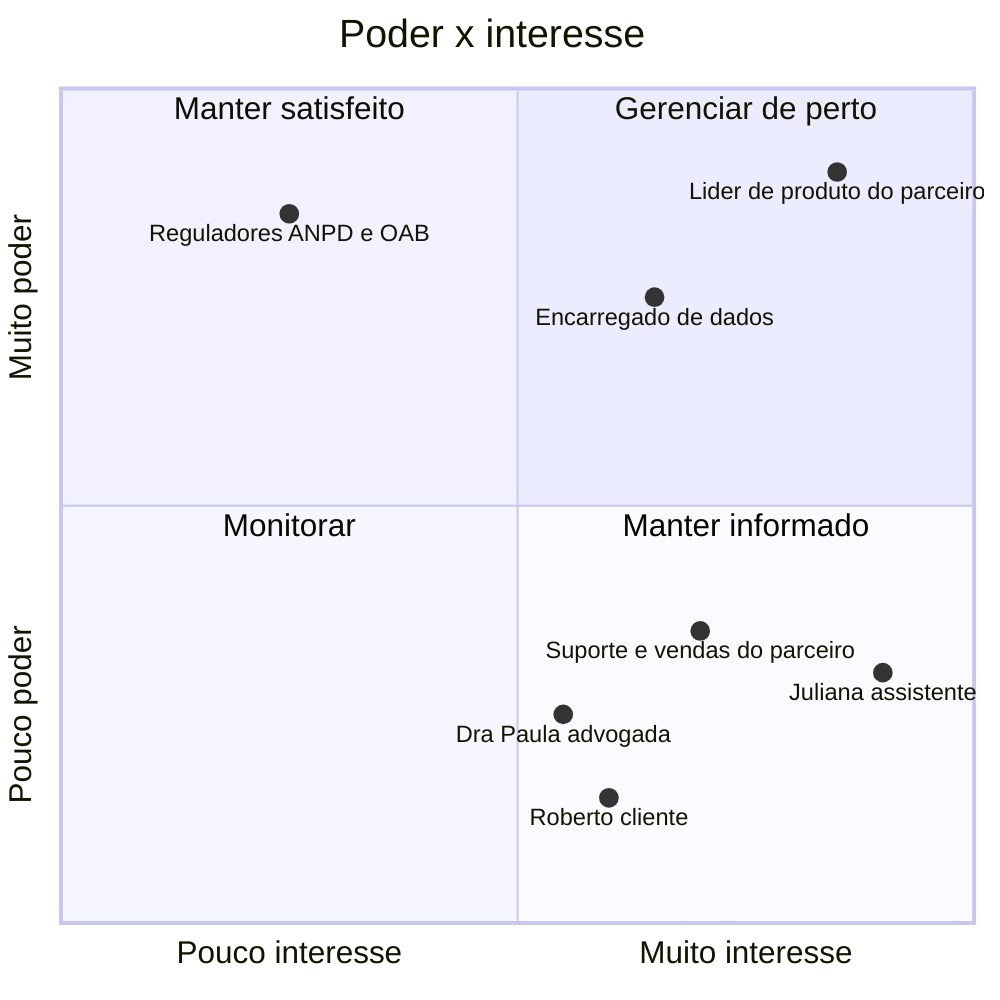

# Etapa 7: Business case

**Status:** ✅ Concluída · 11/11/2026
**Papéis:** PM

> **Hipotético.** Este projeto é um estudo de caso, não um produto comercial, e não pretende concorrer com softwares de gestão jurídica. O business case responde a uma pergunta de exercício: **se este estudo virasse produto, ele se sustentaria?** Todos os números são suposições declaradas.

---

## 1. Modelo de receita

**Faixas mensais por volume de cadastros.** O escritório escolhe um plano com limite de cadastros concluídos por mês.

| Alternativa | Por que não foi escolhida |
|---|---|
| Por cadastro concluído | Acompanha o valor, mas a receita do escritório e a do produto oscilam todo mês |
| Assinatura por assento (por assistente) | Previsível, mas o escritório que usa pouco paga o mesmo que o de massa |

### Preço pelo valor gerado

O preço parte do que o escritório **poupa**, e não do custo do produto.

| Suposição | Valor | Origem |
|---|---|---|
| Tempo poupado por cadastro | ~8 min | Hipótese; será medida pelo resultado-chave de tempo de cadastro (KR3) |
| Custo da hora de uma assistente, com encargos | ~R$ 30 | Suposição |
| **Economia por cadastro** | **~R$ 4** | 8 min × R$ 30/h |
| Parcela cobrada | ~30% | O escritório fica com cerca de 70% do ganho |
| **Preço de referência por cadastro** | **~R$ 1,20** | |

### Faixas

Volumes baseados nas [entrevistas simuladas](../pesquisa/entrevistas-simuladas.md): de 4 a mais de 50 clientes novos por dia, ou cerca de 100 a 1.100 por mês.

| Plano | Cadastros por mês | Preço mensal | Preço por cadastro | Perfil |
|---|---|---|---|---|
| Entrada | até 100 | R$ 149 | R$ 1,49 | Escritório pequeno |
| Escritório | até 300 | R$ 390 | R$ 1,30 | Escritório médio |
| Profissional | até 1.000 | R$ 1.190 | R$ 1,19 | Escritório de alto volume |
| Massa | até 3.000 | R$ 2.990 | R$ 1,00 | Advocacia de massa |

O preço por cadastro cai com o volume, mas fica sempre bem abaixo da economia estimada (~R$ 4).

**Risco do modelo:** se o tempo poupado medido no estudo for menor que 8 minutos, a economia cai e os preços deixam de se justificar. O preço depende diretamente do resultado-chave de tempo de cadastro (KR3).

---

## 2. Custos

### Onde o motor roda

Em produção, o motor roda num servidor próprio na nuvem, e não no computador do escritório ([ADR 0010](../decisoes/0010-motor-em-producao.md)). Isso cria um custo mensal de servidor, mas elimina instalação e suporte em cada escritório.

### Custos mensais do primeiro ano

| Item | Custo mensal | Observação |
|---|---|---|
| **Equipe:** fundador (produto e vendas) e um desenvolvedor | ~R$ 25.000 | Com encargos |
| Servidor do motor (leitura e extração) | ~R$ 1.500 | Ordem de grandeza; depende do volume |
| Hospedagem das páginas, banco, armazenamento, cofre de chaves e backups | ~R$ 1.000 | Ordem de grandeza |
| Ferramentas, domínio e contabilidade | ~R$ 500 | |
| **Total fixo** | **~R$ 28.000** | |

**Custo variável:** cerca de R$ 0,10 por cadastro (processamento e armazenamento), pequeno diante do preço de R$ 1,00 a R$ 1,49 por cadastro.

### Ponto de equilíbrio

| Se a carteira for… | Receita média por escritório | Escritórios necessários |
|---|---|---|
| Só plano Escritório (até 300 cadastros) | R$ 390 | ~72 |
| Mistura dos quatro planos | ~R$ 700 | ~40 |
| Só plano Profissional (até 1.000 cadastros) | R$ 1.190 | ~24 |

**Leitura:** o produto se paga com algumas dezenas de escritórios, se eles forem de alto volume. Com escritórios pequenos, o número necessário cresce rápido.

**Risco da equipe:** com duas pessoas, ninguém se dedica a suporte nem a LGPD. Num produto que guarda documentos de identificação, um incidente de segurança ou uma demanda de titular pode parar o desenvolvimento.

---

## 3. Tamanho do mercado

**Método:** cada ação de consumidor pressupõe o cadastro de um cliente. O mercado é estimado pelo número de ações novas por ano multiplicado pelo preço por cadastro.

### Dados públicos

| Dado | Valor | Fonte |
|---|---|---|
| Casos novos no Judiciário em 2025 | 39,7 milhões | [CNJ](https://www.cnj.jus.br/judiciario-inicia-2026-com-o-menor-estoque-de-processos-pendentes-em-seis-anos/) |
| Participação do direito do consumidor nos casos novos | ~10% (dado de 2020) | [ABJ, via Consumidor Moderno](https://consumidormoderno.com.br/erros-numericos-direito-consumidor/) |
| Casos novos de direito do consumidor | de 2 milhões (relatório de 2015) a 4,3 milhões (2021) por ano | [CNJ, via Sedep](https://www.sedep.com.br/?p=71324), [Conjur](https://www.conjur.com.br/2021-out-23/acoes-direito-consumidor-caem-30-justica-estadual//?print=1) |
| Casos novos na Justiça do Trabalho em 2024 | 3,6 milhões | [TST, Relatório Geral](https://www.tst.jus.br/web/estatistica/jt/relatorio-geral) |

**Ressalva:** o CNJ mudou a forma de contar em 2023, e um processo pode ter mais de um assunto. Os números indicam a ordem de grandeza, não um valor exato.

### Estimativa

| Camada | Suposição | Cadastros por ano | Receita anual possível (R$ 1,20 por cadastro) |
|---|---|---|---|
| **Mercado total** | Todas as ações de consumidor | 2 a 4 milhões | R$ 2,4 a 4,8 milhões |
| **Mercado alcançável** | Metade passa por escritórios com advogado (muitas ações nos juizados especiais dispensam advogado) | 1 a 2 milhões | R$ 1,2 a 2,4 milhões |
| **Ponto de equilíbrio** | Custo fixo de R$ 28 mil por mês | ~280 mil | R$ 336 mil |

**O que a estimativa revela:** para se pagar só com direito do consumidor, o produto precisaria cadastrar **de 14% a 28% de todos os clientes do mercado alcançável**. É uma participação muito alta para um produto novo. O preço por cadastro, que é baixo porque acompanha o valor gerado, faz o mercado parecer grande em volume e pequeno em receita.

A Justiça do Trabalho tem um volume parecido (3,6 milhões de casos novos por ano), mas exige outros documentos (carteira de trabalho, contracheques, rescisão e FGTS), hoje fora do escopo.

---

## 4. Go-to-market: licenciamento para softwares jurídicos

**Decisão:** em vez de vender direto a escritórios, o produto é licenciado como **componente** para softwares de gestão jurídica. Eles incorporam a captura e a extração ao próprio sistema e revendem aos escritórios que já atendem. O produto passa a ser **parceiro** desses softwares, e não concorrente, o que é coerente com o enquadramento do estudo.

**Por que:** a venda direta exigiria cadastrar de 14% a 28% de todos os clientes do mercado alcançável só para empatar. Os softwares jurídicos já estão dentro dos escritórios, e poucos parceiros cobrem uma parcela grande do mercado.

### Modelo de cobrança: fixo mais variável

| Componente | Valor |
|---|---|
| Taxa anual por parceiro | R$ 40 mil |
| Valor por cadastro processado | R$ 0,30 |

As faixas da seção 1 deixam de ser o preço do produto e passam a ser uma **referência** para o preço que o parceiro cobra do escritório. A diferença é a margem do parceiro.

### Ponto de equilíbrio com parceiros

Custo fixo anual: ~R$ 336 mil.

| Parceiros | Receita fixa | Cadastros necessários por ano | Parcela do mercado alcançável |
|---|---|---|---|
| 3 | R$ 120 mil | ~720 mil | 36% a 72% |
| 5 | R$ 200 mil | ~450 mil | 23% a 45% |
| 8 | R$ 320 mil | ~50 mil | 3% a 5% |

**Leitura:** a taxa fixa é o que sustenta o modelo. Com oito parceiros, ela quase cobre sozinha o custo fixo, e o valor por cadastro vira crescimento. Com três, o produto continua dependendo de uma fatia muito alta do mercado.

| Alternativa | Por que não foi escolhida |
|---|---|
| Só por cadastro, no atacado (~R$ 0,50) | Exigiria de 34% a 67% do mercado alcançável |
| Só licença anual fixa (~R$ 120 mil) | Previsível, mas difícil de vender sem provar volume |
| Ampliar para ações trabalhistas | Dobra o mercado, mas exige novos tipos de documento; fica como expansão futura |
| Registrar como inviável | O licenciamento mostrou um caminho possível; a conclusão seria precipitada |

### O que muda no produto

- **API e componente incorporável:** a captura pelo celular e a tela de revisão precisam funcionar dentro do sistema do parceiro, com a marca dele.
- **Multiempresa:** cada parceiro atende muitos escritórios, o que reforça o isolamento entre escritórios do [ADR 0008](../decisoes/0008-armazenamento-em-producao.md).
- **Ciclo de venda longo:** vender a um software jurídico exige provar acurácia e segurança antes. Os resultados do estudo (Etapa 13) seriam o primeiro material de venda.

---

## 5. Stakeholders

Com o licenciamento, o **comprador** passa a ser o software parceiro: o líder de produto dele decide incorporar o componente, e o escritório só escolhe ativar o recurso.

🖼️ [Ver como imagem](img/07-business-case-01-stakeholders.png)

| Stakeholder | Quadrante | O que importa para ele | Como lidar |
|---|---|---|---|
| **Líder de produto do parceiro** | Gerenciar de perto | Diferencial para o software dele, sem risco de segurança nem de suporte | Provar acurácia e segurança com os resultados do estudo; integração simples |
| **Encarregado de dados** (escritório e parceiro) | Gerenciar de perto | Base legal, retenção, registro de acessos, resposta a incidentes | Documentação de segurança pronta ([ADR 0008](../decisoes/0008-armazenamento-em-producao.md), [ADR 0009](../decisoes/0009-registro-de-auditoria-no-estudo.md)); pode vetar a compra |
| **Reguladores** (ANPD e OAB) | Manter satisfeito | Proteção de dados pessoais; ética profissional na relação com o cliente | Conformidade com a LGPD desde o desenho; o produto não capta clientes, só cadastra quem já contratou |
| **Suporte e vendas do parceiro** | Manter informado | Explicar e vender o recurso aos escritórios sem gerar chamados | Material de treinamento e textos da página de captura claros para o cliente |
| **Juliana**, assistente de cadastro | Manter informado | Cadastrar rápido e sem erro | É a usuária principal: sessões de teste e métricas de revisão |
| **Roberto**, cliente | Manter informado | Enviar os documentos fácil e com segurança | Página de captura simples; transparência sobre quem acessa os documentos |
| **Dra. Paula**, advogada | Manter informado | Dados certos para a petição | Marcação de dado errado depois da confirmação |

**Leitura:** o produto é usado por quem tem pouco poder de decisão (Juliana e Roberto) e comprado por quem não o usa (o líder de produto do parceiro). O argumento de venda precisa traduzir o ganho da Juliana em diferencial para o parceiro, e o encarregado de dados pode barrar a venda mesmo com o comprador convencido.

---

## Conclusão do business case

| Pergunta | Resposta |
|---|---|
| Vender direto aos escritórios se sustenta? | **Não**, com o preço baseado no valor gerado: exigiria de 14% a 28% de todo o mercado alcançável |
| Existe um caminho? | **Licenciar para softwares jurídicos**, com taxa fixa e valor por cadastro; com cerca de 8 parceiros, o custo fixo fica coberto |
| O que precisa ser verdade? | O produto poupar de fato ~8 min por cadastro (resultado-chave de tempo, KR3), e a acurácia se manter ao trocar o Apple Vision pelo PaddleOCR ([ADR 0010](../decisoes/0010-motor-em-producao.md)) |
| Maior risco | Ciclo de venda longo com parceiros, que exigem prova de acurácia e segurança antes de assinar |
