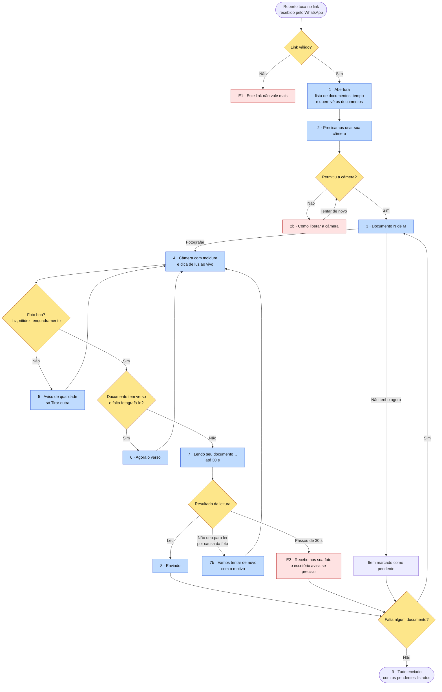

# Wireframes e textos da página de captura

**Versão:** 0.1 · 11/11/2026 · rascunho para aprovação
**Etapa:** [9, captura pelo celular](../../README.md#roteiro) · **Papéis:** UX, Front-end
**Base:** [jornada do Roberto com o produto](../etapas/04-estrategia.md#roberto-com-o-produto-passo-a-passo)
**Figma:** [Extração de documentos · Wireframes da captura](https://www.figma.com/design/SRwA8xYCHp8B8c2QtufKyv), com as 13 telas em formato de celular (360 × 720) e os componentes reutilizáveis (botões, rodapé de privacidade, espaço para imagem)

## Decisões de base

| Decisão | Escolha | Motivo |
|---|---|---|
| Estrutura | **Passo a passo:** um documento por tela, com indicador "2 de 3" | Menos escolhas para quem tem pouca familiaridade com tecnologia |
| Câmera | **Dentro da página**, com moldura e dica de luz ao vivo | Orienta a foto antes de ela ser tirada (RF-05) |
| Tom | **Próximo e simples:** "você", frases curtas, sem termos jurídicos ou técnicos | O Roberto não conhece o sistema e está sozinho (HU-14) |

**Risco da câmera dentro da página:** ela depende da permissão de câmera do navegador. Se o Roberto negar, a página não tem outra forma de fotografar. A tela 2b explica como liberar a permissão.

## Fluxo das telas



🖼️ [Ver como imagem](img/captura-wireframes-01-fluxo-das-telas.png)

**Legenda:** 🟦 tela · 🟥 exceção · 🟨 decisão do sistema

---

## Telas

### 1 · Abertura

```
┌──────────────────────────────┐
│ Escritório Exemplo           │
│                              │
│ Olá! Vamos enviar seus       │
│ documentos.                  │
│                              │
│ São 3 documentos:            │
│ • RG ou CNH                  │
│ • Conta de luz ou água       │
│ • Fatura que você contesta   │
│                              │
│ Leva uns 3 minutos. Tenha os │
│ documentos em mãos.          │
│                              │
│ ┌──────────────────────────┐ │
│ │        Começar           │ │
│ └──────────────────────────┘ │
│                              │
│ 🔒 Só o Escritório Exemplo   │
│ vê seus documentos.          │
│ Saiba mais                   │
└──────────────────────────────┘
```

- A lista vem da que a assistente montou ao gerar o link (RF-33).
- **"Leva uns 3 minutos" é uma promessa** e precisa ser conferida nas sessões com testers (tempo de captura por sessão). Se o tempo medido for maior, o texto muda.
- "Saiba mais" abre um texto curto sobre quem acessa e por quanto tempo (HU-06).

### 2 · Permissão da câmera

```
┌──────────────────────────────┐
│ Precisamos usar sua câmera   │
│                              │
│ Para fotografar os           │
│ documentos, o celular vai    │
│ pedir permissão.             │
│                              │
│ Toque em "Permitir" na       │
│ próxima mensagem.            │
│                              │
│ ┌──────────────────────────┐ │
│ │       Entendi            │ │
│ └──────────────────────────┘ │
└──────────────────────────────┘
```

- Explica **antes** do aviso do navegador, para o Roberto não negar por susto.

### 2b · Câmera negada

```
┌──────────────────────────────┐
│ A câmera está bloqueada      │
│                              │
│ Sem ela não dá para          │
│ fotografar os documentos.    │
│                              │
│ Para liberar:                │
│ 1. Toque no "aA" ou no       │
│    cadeado ao lado do        │
│    endereço                  │
│ 2. Permita a câmera          │
│ 3. Toque em "Tentar de novo" │
│                              │
│ ┌──────────────────────────┐ │
│ │     Tentar de novo       │ │
│ └──────────────────────────┘ │
└──────────────────────────────┘
```

### 3 · Documento N de M

```
┌──────────────────────────────┐
│ Documento 2 de 3      ●●○    │
│                              │
│ Conta de luz ou água         │
│ Serve para comprovar seu     │
│ endereço.                    │
│                              │
│ ┌──────────────────────────┐ │
│ │      📷 Fotografar       │ │
│ └──────────────────────────┘ │
│                              │
│        Não tenho agora       │
│                              │
│ 🔒 Só o escritório vê        │
└──────────────────────────────┘
```

- "Não tenho agora" marca o item como pendente e passa ao próximo (RF-34).

### 4 · Câmera

```
┌──────────────────────────────┐
│ ┌──────────────────────────┐ │
│ │                          │ │
│ │  ┌────────────────────┐  │ │
│ │  │                    │  │ │
│ │  │  moldura do        │  │ │
│ │  │  documento         │  │ │
│ │  │                    │  │ │
│ │  └────────────────────┘  │ │
│ │                          │ │
│ │  💡 Procure mais luz     │ │
│ └──────────────────────────┘ │
│                              │
│            ( ◯ )             │
│   Cancelar                   │
└──────────────────────────────┘
```

- Dicas ao vivo, uma por vez: "Procure mais luz" · "Aproxime o documento" · "Segure firme" · "Pronto, pode fotografar".

### 5 · Aviso de qualidade

```
┌──────────────────────────────┐
│ [miniatura da foto]          │
│                              │
│ A foto ficou escura          │
│ Tente perto de uma janela ou │
│ com a luz acesa.             │
│                              │
│ ┌──────────────────────────┐ │
│ │      Tirar outra         │ │
│ └──────────────────────────┘ │
└──────────────────────────────┘
```

- Motivos possíveis: escura · tremida · cortada · com reflexo.
- Quando a foto está boa, a tela é pulada.
- **Não há "usar mesmo assim":** a foto só segue quando passa na checagem de qualidade. Risco aceito: quem está num lugar muito escuro pode ficar preso nesta tela até mudar de lugar.

### 6 · Verso

```
┌──────────────────────────────┐
│ ✅ Frente da CNH             │
│                              │
│ Agora vire o documento e     │
│ fotografe o verso.           │
│                              │
│ ┌──────────────────────────┐ │
│ │   📷 Fotografar o verso  │ │
│ └──────────────────────────┘ │
└──────────────────────────────┘
```

- Só para RG, CNH física e CIN (RF-06).

### 7 · Lendo seu documento

```
┌──────────────────────────────┐
│                              │
│        ◐  Lendo seu          │
│           documento…         │
│                              │
│   Isso leva alguns segundos. │
│   Mantenha o documento por   │
│   perto.                     │
│                              │
└──────────────────────────────┘
```

- Espera de até 30 s (RF-31). "Mantenha o documento por perto" prepara para uma possível nova foto.

### 7b · Vamos tentar de novo

```
┌──────────────────────────────┐
│ Não conseguimos ler o número │
│ do documento                 │
│                              │
│ Pode ser reflexo de luz.     │
│ Incline um pouco o documento │
│ e fotografe de novo.         │
│                              │
│ ┌──────────────────────────┐ │
│ │     Fotografar de novo   │ │
│ └──────────────────────────┘ │
└──────────────────────────────┘
```

- O motivo vem do motor, sem nenhum dado do documento: só o que faltou ler e a causa provável.

### 8 · Enviado

```
┌──────────────────────────────┐
│ ✅ Conta de luz enviada      │
│                              │
│ ┌──────────────────────────┐ │
│ │   Próximo: Fatura  →     │ │
│ └──────────────────────────┘ │
└──────────────────────────────┘
```

### 9 · Tudo enviado

```
┌──────────────────────────────┐
│ ✅ Pronto!                   │
│                              │
│ O Escritório Exemplo já      │
│ recebeu seus documentos.     │
│                              │
│ ✅ RG ou CNH                 │
│ ✅ Fatura                    │
│ ⏸ Conta de luz: você disse  │
│   que não tem agora. O       │
│   escritório vai te mandar   │
│   um novo link.              │
│                              │
│ Pode fechar esta página.     │
│ As fotos não ficam salvas    │
│ no seu celular.              │
└──────────────────────────────┘
```

### E1 · Link expirado ou já usado

```
┌──────────────────────────────┐
│ Este link não vale mais      │
│                              │
│ Ele já foi usado ou passou   │
│ do tempo. Peça um novo ao    │
│ escritório.                  │
└──────────────────────────────┘
```

### E2 · Tempo de leitura esgotado

```
┌──────────────────────────────┐
│ ✅ Recebemos sua foto        │
│                              │
│ A leitura está demorando. Se │
│ for preciso outra foto, o    │
│ escritório avisa você.       │
│                              │
│ ┌──────────────────────────┐ │
│ │   Próximo documento →    │ │
│ └──────────────────────────┘ │
└──────────────────────────────┘
```

---

## Acessibilidade e responsividade

- Botões de pelo menos 48 px de altura, ocupando a largura da tela.
- Contraste AA em todos os textos; as dicas da câmera ficam sobre uma faixa escura, e não direto sobre a imagem.
- Toda mudança de estado ("Lendo…", "Enviado") é anunciada aos leitores de tela.
- Funciona com uma mão: as ações principais ficam na metade de baixo da tela.
