# Wireframes e textos da página de captura

**Versão:** 1.0 · aprovada em 11/11/2026
**Etapa:** [9, captura pelo celular](../../README.md#roteiro) · **Papéis:** UX, Front-end
**Base:** [jornada do Roberto com o produto](../etapas/04-estrategia.md#roberto-com-o-produto-passo-a-passo)
**Figma:** [Extração de documentos · Wireframes da captura](https://www.figma.com/design/SRwA8xYCHp8B8c2QtufKyv), com as 13 telas em formato de celular (360 × 720) e os componentes reutilizáveis (botões, rodapé de privacidade, espaço para imagem)
**Guia visual:** [cores, tipografia, espaçamentos e componentes](guia-visual.html) (abra o arquivo no navegador)

## Decisões de base

| Decisão | Escolha | Motivo |
|---|---|---|
| Estrutura | **Passo a passo:** um documento por tela, com indicador "2 de 3" | Menos escolhas para quem tem pouca familiaridade com tecnologia |
| Câmera | **Dentro da página**, com moldura e dica de luz ao vivo | Orienta a foto antes de ela ser tirada (RF-05) |
| Tom | **Próximo e simples:** "você", frases curtas, sem termos jurídicos ou técnicos | O Roberto não conhece o sistema e está sozinho (HU-14) |

**Risco da câmera dentro da página:** ela depende da permissão de câmera do navegador. Se o Roberto negar, a página não tem outra forma de fotografar. A tela 2b explica como liberar a permissão.

## Fluxo das telas

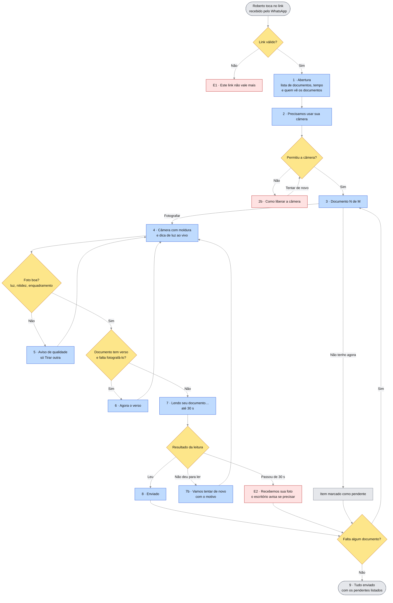

🖼️ [Ver como imagem](img/captura-wireframes-01-fluxo-das-telas.png)

**Legenda:** 🟦 tela · 🟥 exceção · 🟨 decisão do sistema · ⬜ início, fim e pendência

---

## Telas

Visão geral, na ordem da jornada. Os detalhes de cada tela estão nas seções abaixo.

| | | | |
|---|---|---|---|
| 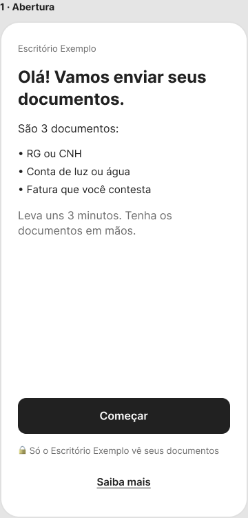 **1 · Abertura** | 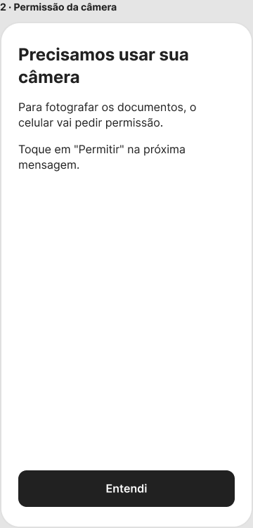 **2 · Permissão da câmera** | 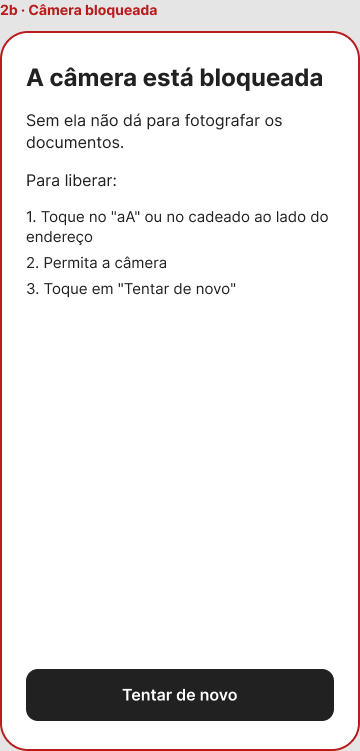 **2b · Câmera negada** | 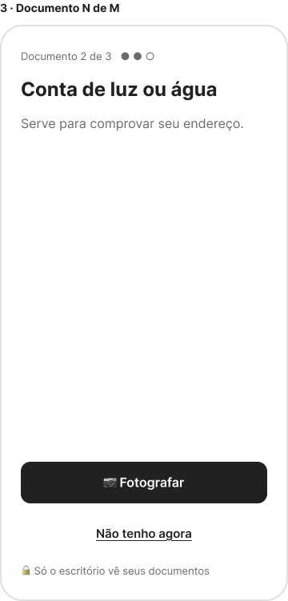 **3 · Documento N de M** |
| 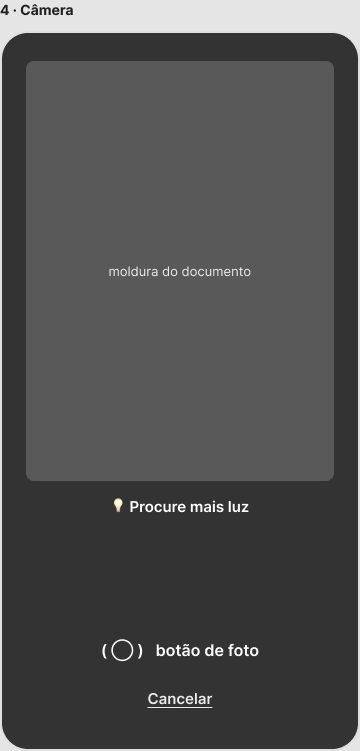 **4 · Câmera** | 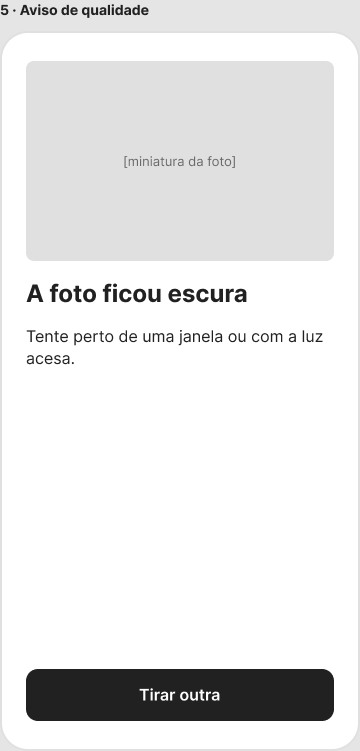 **5 · Aviso de qualidade** | 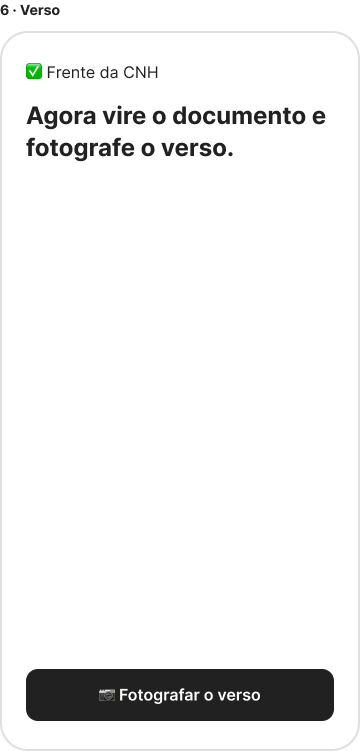 **6 · Verso** | 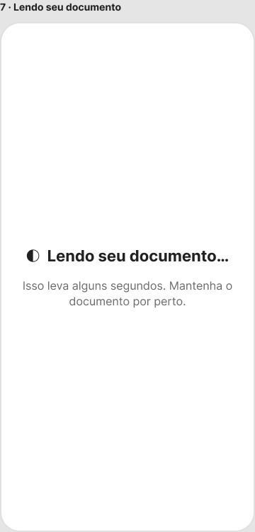 **7 · Lendo seu documento** |
| 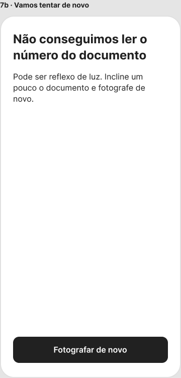 **7b · Vamos tentar de novo** | 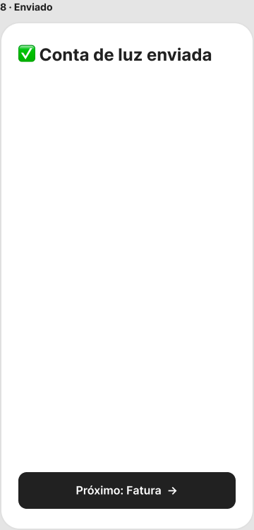 **8 · Enviado** | 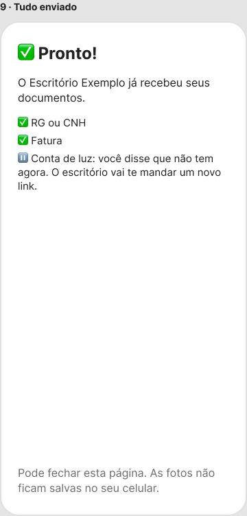 **9 · Tudo enviado** | 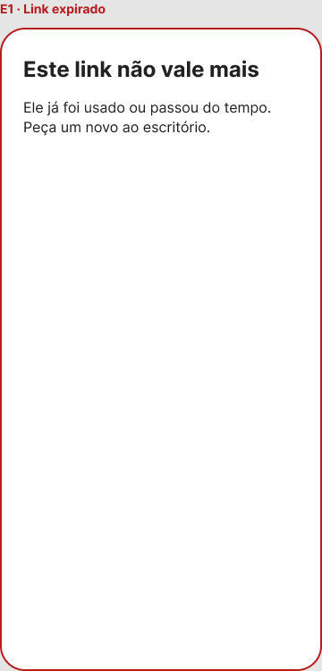 **E1 · Link expirado ou já usado** |
| 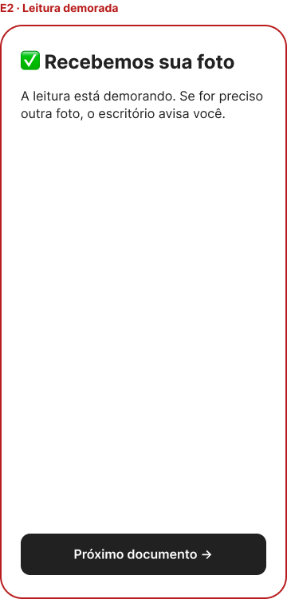 **E2 · Tempo de leitura esgotado** |  |  |  |

### 1 · Abertura

- A lista vem da que a assistente montou ao gerar o link (RF-33).
- **"Leva uns 3 minutos" é uma promessa** e precisa ser conferida nas sessões com testers (tempo de captura por sessão). Se o tempo medido for maior, o texto muda.
- "Saiba mais" abre um texto curto sobre quem acessa e por quanto tempo (HU-06).

### 2 · Permissão da câmera

- Explica **antes** do aviso do navegador, para o Roberto não negar por susto.

### 2b · Câmera negada

### 3 · Documento N de M

- "Não tenho agora" marca o item como pendente e passa ao próximo (RF-34).

### 4 · Câmera

- Dicas ao vivo, uma por vez: "Procure mais luz" · "Aproxime o documento" · "Segure firme" · "Pronto, pode fotografar".

### 5 · Aviso de qualidade

- Motivos possíveis: escura · tremida · cortada · com reflexo.
- Quando a foto está boa, a tela é pulada.
- **Limite de 3 tentativas** (revisto no primeiro teste no celular, 11/11/2026): na terceira foto recusada seguida, a última segue para o motor, que ainda pode pedir outra (tela 7b). Antes, só existia "Tirar outra", e o teste mostrou o risco de o cliente ficar preso.
- **O celular barra só o óbvio:** foto muito escura ou muito tremida. O reflexo deixou de bloquear, porque a regra recusava papel branco bem iluminado e fotos de tela. Quem decide se dá para ler é o motor (RF-31).

### 6 · Verso

- Só para RG, CNH física e CIN (RF-06).

### 7 · Lendo seu documento

- Espera de até 30 s (RF-31). "Mantenha o documento por perto" prepara para uma possível nova foto.

### 7b · Vamos tentar de novo

- O motivo vem do motor, sem nenhum dado do documento: só o que faltou ler e a causa provável.

### 8 · Enviado

### 9 · Tudo enviado

### E1 · Link expirado ou já usado

### E2 · Tempo de leitura esgotado

---

## Acessibilidade e responsividade

- Botões de pelo menos 48 px de altura, ocupando a largura da tela.
- Contraste AA em todos os textos; as dicas da câmera ficam sobre uma faixa escura, e não direto sobre a imagem.
- Toda mudança de estado ("Lendo…", "Enviado") é anunciada aos leitores de tela.
- Funciona com uma mão: as ações principais ficam na metade de baixo da tela.
