# Telas finais do produto

**Versão atual:** 1.2 · 11/11/2026 · telas reais do sistema, capturadas em alta resolução no modo de demonstração

As imagens abaixo são do **produto funcionando**, e não de desenho: cada uma foi capturada da própria aplicação, com dados fictícios. Para reproduzir ou apresentar ao vivo, use o modo de demonstração:

- Celular: `captura.html?demo=<tela>` (por exemplo `?demo=camera`)
- Escritório: `escritorio.html?demo=1` (lista), `?demo=revisao` (tela de revisão) e `?demo=conferencia` (conferência do cliente)

## Histórico das versões

| Versão | O que é | Onde |
|---|---|---|
| 1.0 · wireframes | 13 telas de baixa fidelidade, aprovadas antes do código | [Figma, página "v1.0 · Wireframes"](https://www.figma.com/design/SRwA8xYCHp8B8c2QtufKyv) e [`img/telas-v1.0-wireframes/`](img/telas-v1.0-wireframes/) |
| 1.1 · produto | Telas reais, depois dos testes no celular | [Figma, página "v1.1 · Produto"](https://www.figma.com/design/SRwA8xYCHp8B8c2QtufKyv) e [`img/telas-v1.1-produto/`](img/telas-v1.1-produto/) |
| 1.2 · produto | Importação de arquivos no celular e conferência do cliente no escritório | [Figma, página "v1.2 · Produto"](https://www.figma.com/design/SRwA8xYCHp8B8c2QtufKyv) e [`img/telas-v1.2-produto/`](img/telas-v1.2-produto/) |

### O que mudou do wireframe 1.0 para o produto 1.1

| Tela | Mudança | Motivo |
|---|---|---|
| Todas | Visual do [guia visual](guia-visual.html): verde-petróleo, fonte do celular, botões de 52 px | Guia aprovado em 11/11/2026 |
| 4 · Câmera | Tela cheia com cantos no lugar da moldura fechada; botão de flash | 2º teste no celular: moldura pequena; pedido de flash |
| 5 · Aviso de qualidade | Na 3ª foto recusada, a última segue para o motor; o reflexo deixou de bloquear | 1º teste no celular: toda foto da tela era recusada |
| 7b · Nova foto | O motivo vem do motor real ("Não conseguimos ler o CPF do documento") | Motor real ligado |
| Escritório | Tela de revisão com a foto ao lado e ✓/✗ por campo | 3º teste: conferência feita "de outra forma" |

### O que mudou da 1.1 para a 1.2

| Tela | Mudança | Motivo |
|---|---|---|
| 3 · Documento N de M | Botão "Importar dos arquivos" (galeria ou PDF) entre "Fotografar" e "Não tenho agora" | Pedido do autor: o cliente pode já ter o documento no celular (CNH digital, fatura em PDF) |
| Escritório · lista | Botão "Conferência do cliente" nos documentos já revisados | Incremento 4: medir a métrica de proteção e o KR1 |
| Escritório · conferência (nova) | O cliente confere, na tela do Mac, os dados já confirmados e marca "Está errado?" | Medição sem devolver dados ao celular do cliente |

## Telas da versão atual (1.2)

### Celular · página de captura

| | | | |
|---|---|---|---|
| 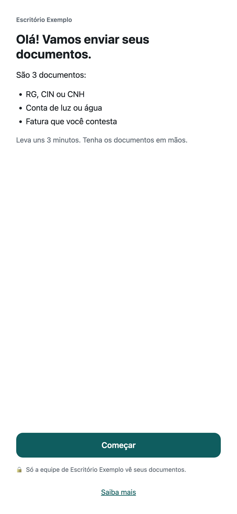 **1 · Abertura** | 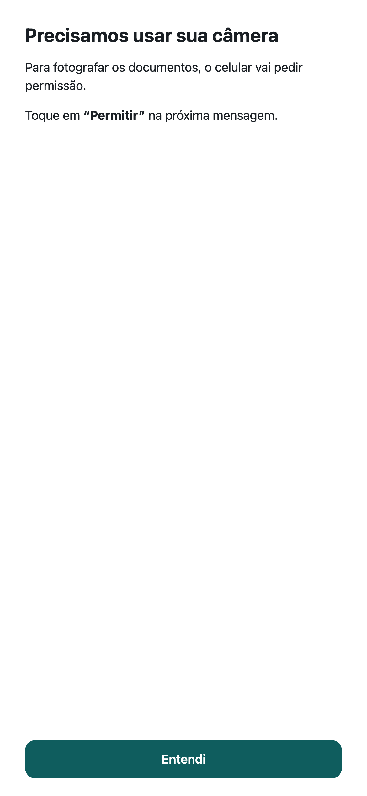 **2 · Permissão** | 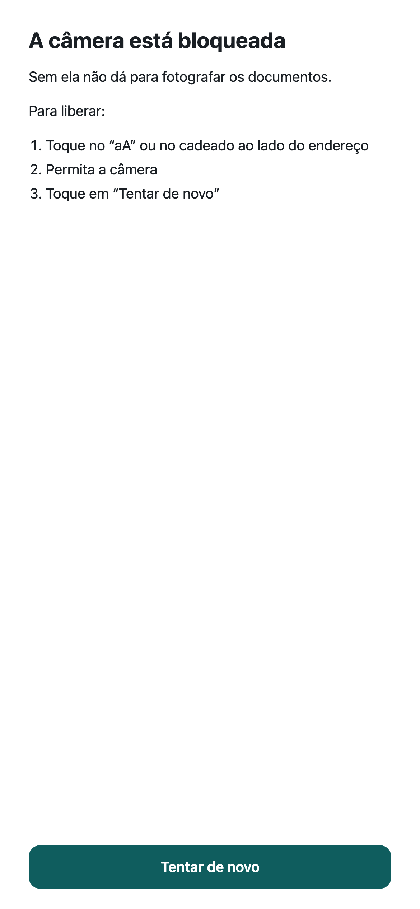 **2b · Câmera bloqueada** | 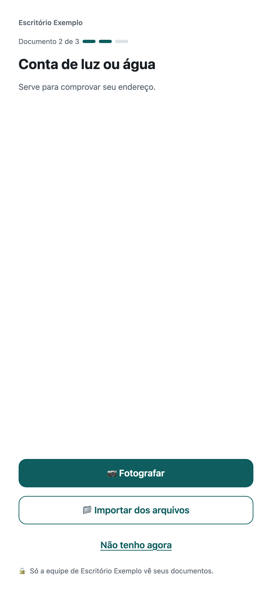 **3 · Documento N de M** |
| 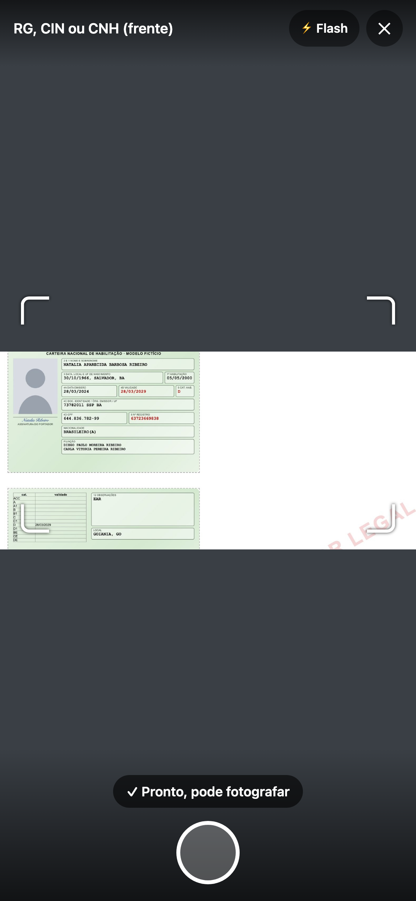 **4 · Câmera** | 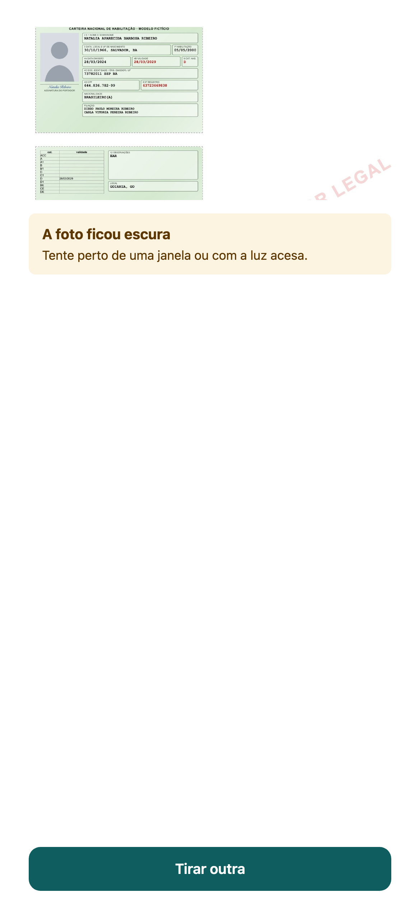 **5 · Aviso de qualidade** | 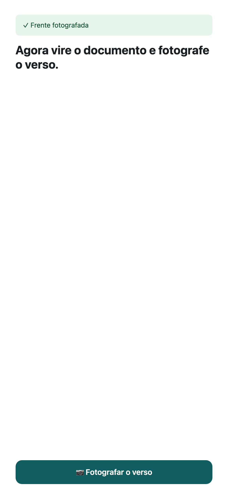 **6 · Verso** | 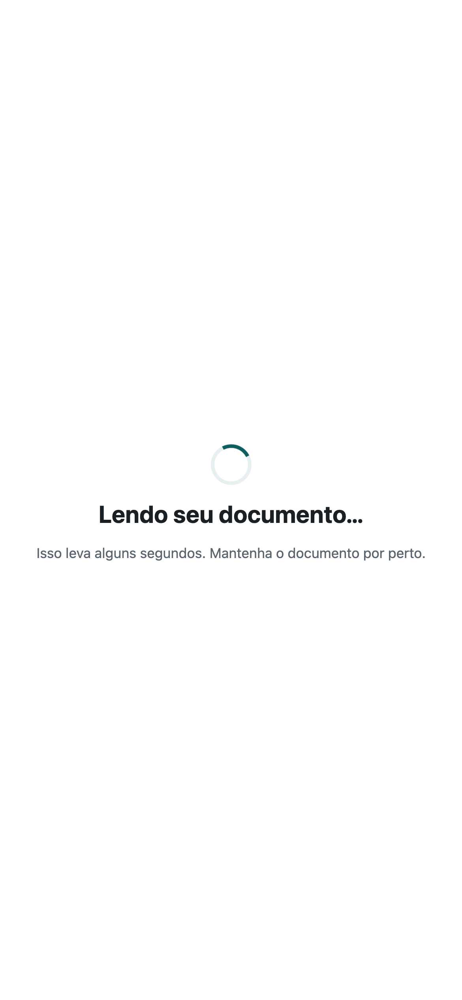 **7 · Lendo** |
| 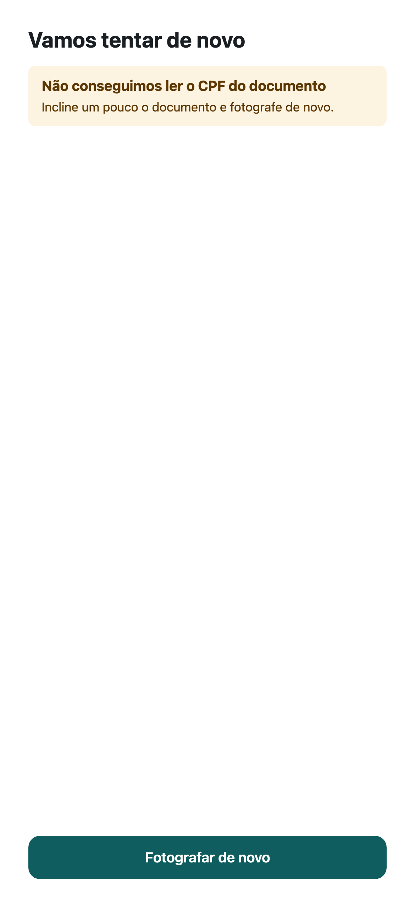 **7b · Nova foto** | 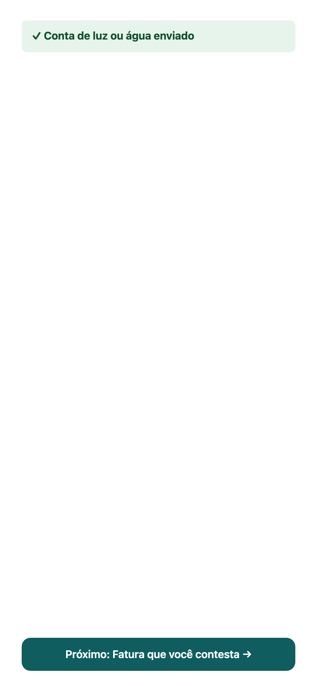 **8 · Enviado** | 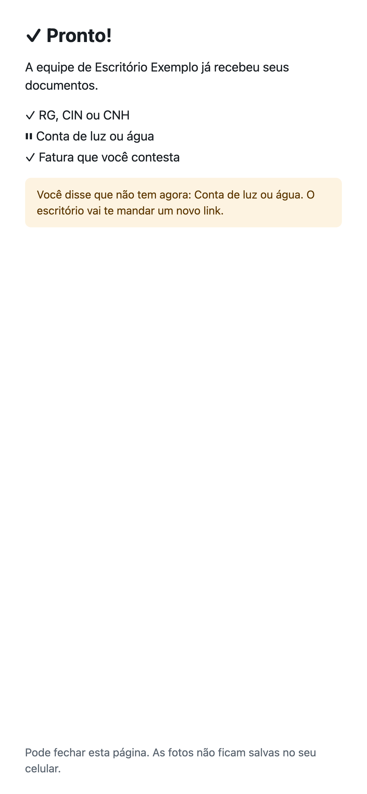 **9 · Tudo enviado** | 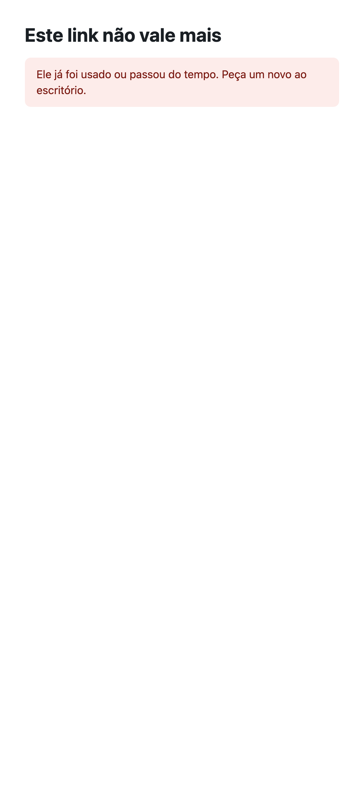 **E1 · Link expirado** |
| 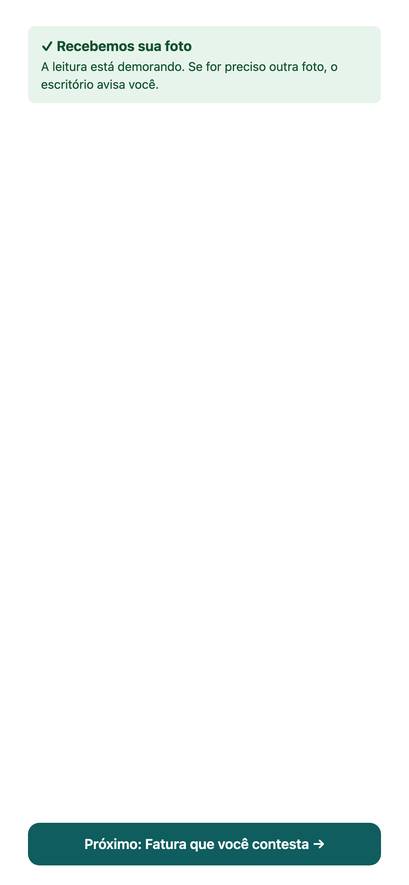 **E2 · Leitura demorada** | | | |

### Escritório

**Novo cadastro**
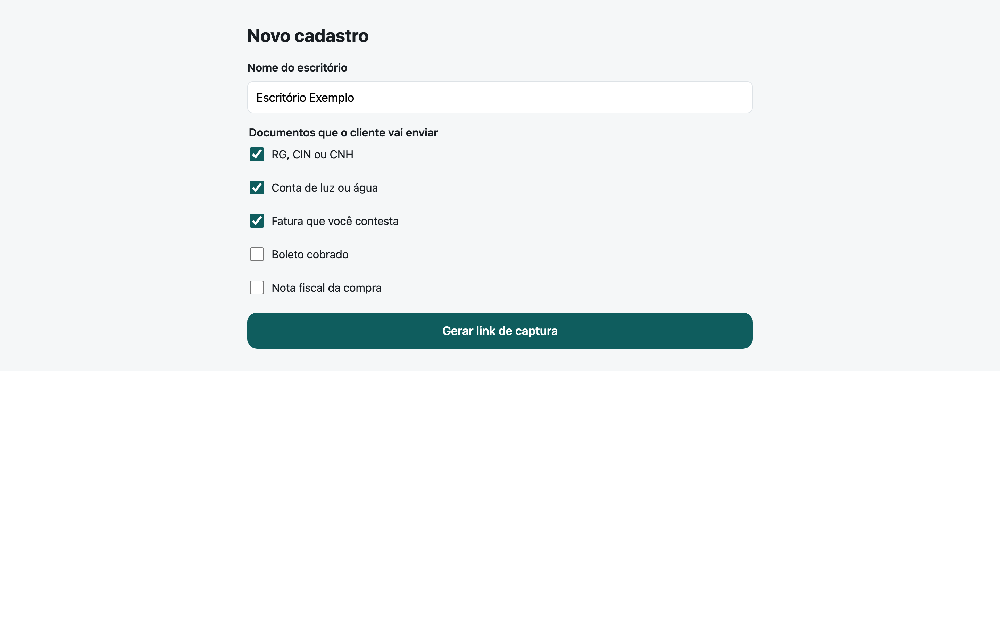

**Cadastro com os documentos recebidos**
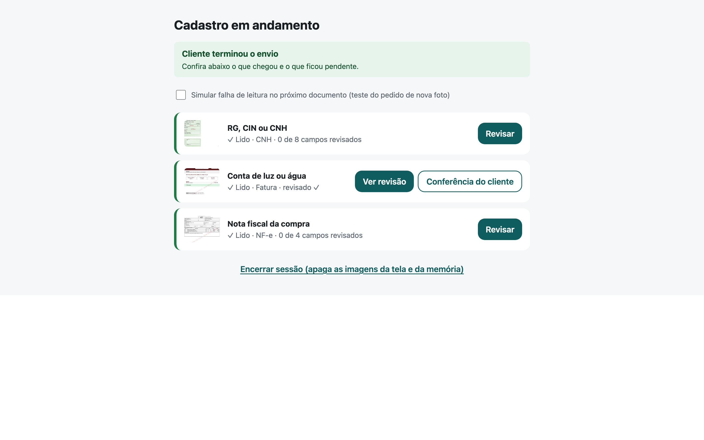

**Tela de revisão:** foto ao lado dos dados, ✓/✗ por campo, campos da IA primeiro
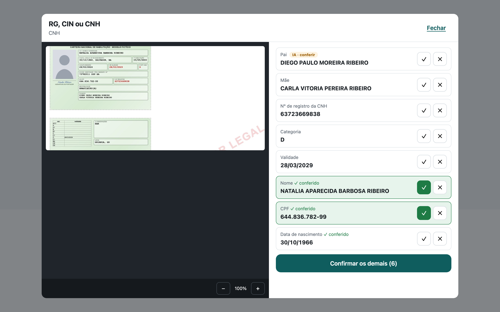

**Conferência do cliente (nova na 1.2):** o cliente marca o que estiver errado nos dados já confirmados
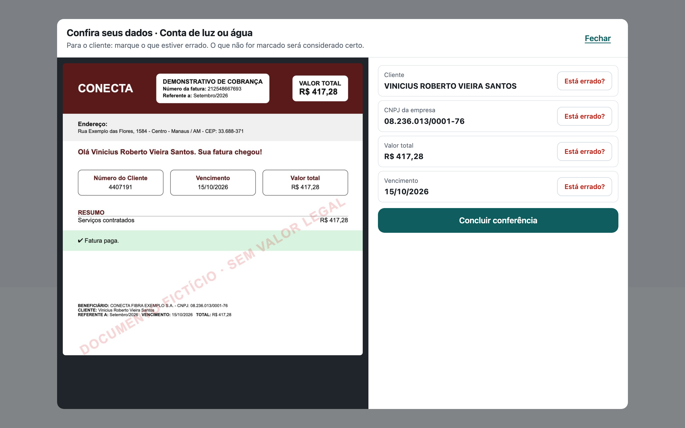
